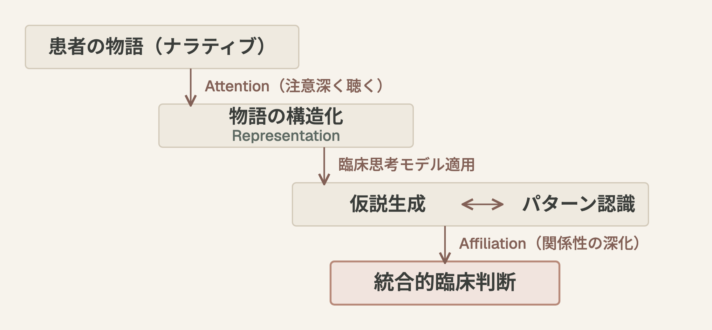

# 🎓 デジタル時代のナラティブ・メディスン
## 物語の力 × 臨床思考 × デジタルツールの統合

**対象:** 研修医・専攻医
**時間:** 30分
**日付:** 2026-03-21
**IDモデル:** ガニェの9教授事象
**ブルーム:** 理解 → 分析 → 創造

---

## スライド1: 導入の問い
### 事象1: 注意の喚起

> 💭 あなたが最近診た患者さんの中で、病歴だけでは捉えきれなかった"何か"を感じた経験はありますか？

---

## スライド2: 今日のゴール
### 事象2: 学習目標

この30分の後、あなたは：

- ナラティブ・メディスンの理論的背景を **説明できる**（理解）
- デジタル・ナラティブの可能性と限界を **論じられる**（分析）
- 統合的アプローチを1つ **導入する計画を立てられる**（創造）

---

## スライド3: ナラティブ・メディスンとは
### 事象3: 前提条件の想起

- 提唱者: Rita Charon（コロンビア大学, 2001）
- 定義: 患者の物語を受け止め、共に意味を紡ぐ臨床態度
- 従来の「科学的医学」への批判ではなく **補完**
- 共感・省察・専門職性・信頼を育む枠組み

---

## スライド4: Charonの3要素
### 事象4: 新しい内容の提示

| 要素 | 意味 | 臨床での実践 |
|------|------|-------------|
| Attention | 注意深く聴く | 患者の語りに意識を向ける |
| Representation | 物語を表現する | 聴いたことを言語化・記録する |
| Affiliation | 繋がりを形成する | 治療的関係を深める |

---

## スライド5: 現状の課題
### 事象4（続き）: 新しい内容の提示

Frontiers in Medicine (2026, ミニレビュー) が挙げる3つの障壁：

- カリキュラム過密 → 時間確保が困難
- 教員の準備不足と組織的支援の不足 → 教え方が体系化されていない
- 標準化・検証済みの評価枠組みの欠如 → 能力測定が未解決

---

## スライド6: 形骸化リスクへの警鐘
### 事象4（続き）

> 📌 ナラティブ教育は「良いこと」として導入されがちだが、構造的な障壁を無視すると形骸化する

---

## スライド7: デジタルが拡張する方向
### 事象4（続き）: 新しい内容の提示

JMIR (2026, 概説記事) が取り上げる3つの応用領域：

- ① 医学教育への応用
- ② 臨床での活用
- ③ 社会的に疎外された人々への応用

---

## スライド8: ① 医学教育への応用
### 事象4（続き）

- 患者・家族・介護者の語りを映像などで教材化し、共感やコミュニケーション、専門職としてのあり方を育てる
- 研修医の振り返りの文章を電子ポートフォリオに残し、指導者が評価する
- 例: 双極症の当事者を撮影した映像を見た精神科研修医が、共感や思いやりの高まりを自己報告（効果の客観的な測定ではない）

---

## スライド9: ② 臨床での活用
### 事象4（続き）

- 患者の心理・感情・社会・スピリチュアルな体験の語りを診療記録に残し、チームで共有できる
- 記録された語りをAIで分析する可能性
- 例: 緩和ケアの再設計で、患者・家族の委員会を最初から関与させた

---

## スライド10: ③ 疎外された人々への応用と課題
### 事象5: 学習の指針

応用例：

- 若者・先住民・精神疾患や物質使用の当事者など、声が届きにくい人々の語りを増幅する
- AIで語りを研修用のシミュレーション場面や臨床判断支援につなげる

課題（JMIR 論考が挙げるもの）：

- 研究・カリキュラム・診療を計画・評価する新しい方法論が必要
- 語り手や家族の同意と、語りの使われ方をめぐる倫理

---

## スライド11: ナラティブ × 臨床思考の統合
### 事象4（続き）: 新しい内容の提示

BMC Medical Education (2026) — 神経内科の臨床実習での比較研究：

- 方法: 臨床医学実習生100名（2クラス・各50名）を、ナラティブ + 臨床思考モデル統合教育群と従来教育群に分けて比較（山東第一医科大学・脳梗塞の章・単施設）
- 結果: 統合群で、筆記試験・症例分析の得点、患者満足度、SEGUE による医師患者間コミュニケーションが有意に高かった（p < 0.05）
- 含意: ナラティブと臨床思考は **相補的でありうる**（著者は「さらなる検討が必要」としている）

---

## スライド12: 統合モデルの流れ
### 事象5: 学習の指針

---

## スライド13: 批判的吟味のポイント
### 事象5（続き）

- Study Designの妥当性（単施設 vs 多施設、サンプルサイズ）
- 「学習成果」の定義と測定方法は適切か
- 神経内科以外への一般化可能性
- 教育者のトレーニング効果の交絡

---

## スライド14: ペアディスカッション
### 事象6: 練習の機会

2人1組で4分：

> 🗣️ あなたの臨床現場で、ナラティブ × 臨床思考 × デジタルツールの統合を1つ実践するとしたら何ができるか

---

## スライド15: 考えるヒント
### 事象6（続き）

- 外来の問診にナラティブ要素を1つ追加するなら
- カンファで「患者の物語」を構造的に共有する方法
- 音声記録やテンプレートをどう使えるか

---

## スライド16: 全体共有
### 事象7: フィードバック

- 2〜3ペアに発表してもらう（2分）
- ファシリテーターは具体的なアクションレベルに落とすフィードバック
- 「やれそう」と「やりたい」が交差する点を拾う

---

## スライド17: 3つの論文が示す全体像
### 事象8: 学習の成果を評価する

| 論文 | 視点 | 臨床への含意 |
|------|------|-------------|
| Frontiers | 理想と障壁 | 制約を知った上で設計する |
| JMIR | デジタルの応用例（概説） | 障壁への対応を考える手がかり |
| BMC | 統合教育の比較研究（単施設） | 「物語＋構造」が有効でありうることを示す一例 |

---

## スライド18: 理解度確認
### 事象8（続き）

> 3つの論文を踏まえて、ナラティブ教育の最大のレバレッジポイントはどこだと思いますか

---

## スライド19: 来週までの1アクション
### 事象9: 保持と転移の促進

次回のカンファまでに1つ試す：

- [ ] 患者の語りに3分間、中断せず耳を傾ける
- [ ] カルテの「現病歴」に患者の言葉を1文そのまま残す
- [ ] 同僚と「心に残った患者の物語」を1つ共有する

---

## スライド20: 持ち帰りの問い
### 事象9（続き）

> デジタルツールがナラティブの「記録」を便利にする一方で、聴く力そのものはテクノロジーでは代替できない
>
> では、デジタル時代に「聴く力」をどう育むか

---

## 参考文献
1. JMIR (2026) — Digital Narrative Medicine: Translating Stories Into Medical Education and Better Patient Care (Sage CM. J Med Internet Res 2026;28:e93037). https://www.jmir.org/2026/1/e93037/
2. Frontiers in Medicine (2026) — Reimagining medical education: integrating medical humanism and narrative medicine into a new educational paradigm (Hou J, Chen J, Guo H. Mini Review). https://www.frontiersin.org/journals/medicine/articles/10.3389/fmed.2026.1761177/full
3. BMC Medical Education (2026) — Application of narrative medicine combined with clinical thinking model in neurology teaching (Cui et al.). https://link.springer.com/article/10.1186/s12909-025-08492-x
4. Charon, R. (2001). Narrative Medicine: A Model for Empathy, Reflection, Profession, and Trust. JAMA, 286(15), 1897-1902.
5. PMC — Digital Narrative Medicine (Full Text). https://pmc.ncbi.nlm.nih.gov/articles/PMC12923091/
