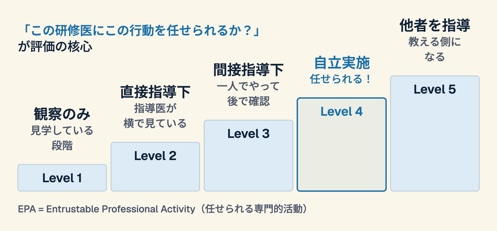

# CBE / EPA
## コンピテンシー基盤型教育とEPA -- 「点数」から「できること」へ

---

## 導入の問い

USMLE（米国医師国家試験）で高得点の研修医が、必ずしも「良い医師」になるとは限らない。-- では、何で評価すればいいのか？

**この30分の後、あなたは：**

- CBE = Competency-Based Education（コンピテンシー基盤型教育）の基本概念を説明できる
- EPA = Entrustable Professional Activity（任せられる専門的活動）とマイルストーン評価を理解できる
- 自分の指導・研修にCBEの要素を1つ取り入れる計画を立てられる

---

## 試験の点数は何を予測するのか？

| 指標 | 事実 | 意味 |
|---|---|---|
| USMLE Step 1 高得点 | 研修中のパフォーマンスとの関連は領域や指標により一貫せず、単独の物差しとしては限られる（系統的レビュー、2023） | 知識 ≠ 能力 |
| クラークシップの最上位評価 | 授与される学生の割合は米国の医学部間で2%〜93%と大きくばらつく（2009-10年度、119校） | 基準が曖昧 |
| 筆記試験 | 「知っている」を測るが「できる」を測らない | 評価方法の不整合 |

「試験に受かる力」と「患者を診る力」は別物。このギャップを埋めるのがCBE。

---

## CBE（コンピテンシー基盤型教育）とは何か

| | 従来の教育 | CBE |
|---|---|---|
| 評価基準 | 時間（何年間研修したか） | 能力（何ができるようになったか） |
| 測定方法 | 筆記試験・口頭試験 | EPA（実際の信頼レベル）+ マイルストーン |
| 指導者の役割 | 試験官・評価者 | コーチ・伴走者 |
| ゴール | 合格ラインを越える | 一人前の医師として任せられる |

**CBE = 「何年研修したか」ではなく「何ができるようになったか」で評価する仕組み**

---

## EPA -- 「任せられる」を段階的に評価する

---

## 「評価者」から「コーチ」へ

| | 従来の指導医 | CBEのコーチ |
|---|---|---|
| スタンス | 「できなかったこと」を指摘 | 「できるようになったこと」を確認 |
| フィードバック | 年に1-2回の総括評価 | 日常的な短い対話 |
| 目的 | 合否判定 | 成長支援 |
| 関係性 | 上下関係 | 伴走・協働 |

「あの先生は厳しい」と言われる指導医から、「あの先生がいると安心」と言われるコーチへ。

---

## 日本での動き（1）制度と研修

- 総合診療専門医を含む新専門医制度は2018年4月に始まった（日本専門医機構）。EPAの導入範囲は施設や領域で異なり、全国統一の運用は確認できていない（2026年11月時点）
- 初期研修の到達目標と評価は2020年度に改訂された（厚生労働省）。EPAそのものではないが、「できること」で評価する方向にある

---

## 日本での動き（2）試験と評価

- USMLE Step 1は2022年1月26日以降の受験分から、点数でなくPass/Failのみの報告になった
- OSCE（客観的臨床能力試験）は、「知っている」でなく「できる」を測る評価として医学教育に組み込まれている

「点数で評価」から「任せられるかで評価」への転換は、日本でも少しずつ進んでいる

---

## ディスカッション

**4分間 → 全体共有 2分**

あなたの研修現場で、「点数では測れないが、医師として重要な能力」は何か？それをどう評価すればいい？

**明日からの1アクション**

- 研修医の「できること」を1つ、EPAのLevelで評価してみる
- 「できなかったこと」ではなく「できたこと」をフィードバックする
- 「次はこれを任せてみようか」という対話を、1回してみる
