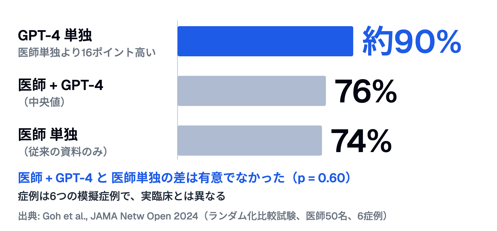
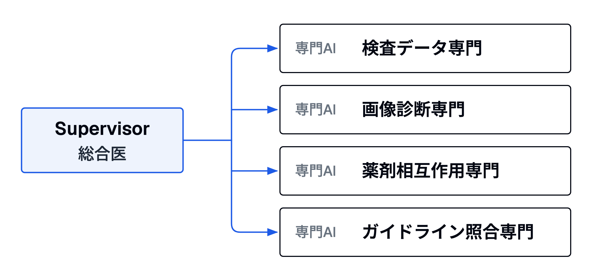

# AI時代の臨床推論 — 使いこなす力と疑う力
## 研修医・専攻医向け統合セッション

対象: 研修医・専攻医
時間: 45分
日付: 2026-03-26

---

## Slide 1: 世界はもうこのフェーズにいる
- **81%の米国医師**が診療でAIを活用（2023年は38%）
- **76%超**が「AIは患者ケアの能力を高める」と考えている
- 出典: AMA 2026年調査（医師1,692人、2026年1〜2月）

---

## Slide 2: しかし意外なデータがある
> LLMを使った医師の診断推論スコアは、LLM単独より低かった
> — Goh et al., JAMA Netw Open 2024（ランダム化比較試験、医師50名、6症例）

---

## Slide 3: 数字で見る逆転
| 条件 | 診断推論スコア |
|---|---|
| GPT-4 単独 | **約90%**（医師単独より16ポイント高い） |
| 医師 + GPT-4 | **76%**（中央値） |
| 医師 単独 | **74%**（従来の資料のみ） |

- 医師+GPT-4と医師単独の差は有意でなかった（p = 0.60）
- 症例は6つの模擬症例で、実臨床とは異なる
- 問い: AIは味方か、それとも新しい罠か？

---

## 診断推論スコアの逆転

---

## Slide 4: 今日のゴール
この45分の後、あなたは:

1. AIの3世代とマルチエージェントを**説明できる**（理解）
2. AIが持つ認知バイアスを**分析できる**（分析）
3. AIを使う/使わない場面を**判断できる**（評価）
4. 自分の研修への組み込み方を**提案できる**（創造）

---

## Slide 5: 前提確認 — あなたとAIの関係
Quick Poll（手元メモか匿名の挙手。答えたくないときは答えなくてよい）:

- AIを臨床で使ったことがある人？
- AIの答えに引きずられた経験がある人？
- 「AIは間違っている」と無視した経験がある人？

---

## Slide 6: どちらも「バイアス」
> 引きずられる反応も、無視する反応も、どちらも認知バイアスの一種です。
> 今日はこの「引きずられる力」と「疑う力」の両方を扱います。

---

## Slide 7: AIの3世代
| 世代 | 特徴 | 医療での例 |
|------|------|-----------|
| 第1世代 ルールベース | 人間がルールを書く | 処方チェック |
| 第2世代 生成AI | 1つのAIが何でもやる | ChatGPTに聞く |
| **第3世代 エージェントAI** | **専門AIチームが協力** | **複数AIで診断支援** |

---

## Slide 8: マルチエージェント = チーム医療のAI版

---

## Slide 9: Mount Sinai研究（2026）の発見
| 発見 | 内容 |
|------|------|
| 精度 | 同時タスクが多い条件でも、単一AIより精度を保った |
| 計算資源 | 最大**65分の1**（シミュレーション条件） |
| 条件 | 情報検索・データ抽出・投薬量計算を最大80件同時。実臨床での検証はこれから |

---

## Slide 10: なぜ「チーム」が強いのか
> 救急外来に10人の患者が同時に来たら——1人のスーパードクターより、専門チーム5人の方が対応できる。
> AIも同じ。

---

## Slide 11: 臨床実装の最前線 — BJC Healthcare
- **機関** BJC Healthcare ACO（HIMSS26発表）
- **内容** 既存の死亡リスクモデルを補う「学習するレビュー役」のAI
- **機能** 記録を読んで終末期に近い可能性のある患者を挙げ、人に知らせる
- **最終判断** アドバンス・ケア・プランニングを勧めるかは臨床医

---

## Slide 12: 監督モデルの変化
| human-in-the-loop | human-on-the-loop |
|-------------------|-------------------|
| AIが提案→人間が毎回承認 | AIが自律実行→人間が監督 |
| 安全だが遅い | 速いが信頼性設計が鍵 |
| 現在の多くの医療AI | 一部で検討が進む形（BJCの例でも最終判断は臨床医） |

---

## Slide 13: 臨床推論の3大認知バイアス
- **アンカリング** 最初の情報に固執する
- **プレマチュアクロージャー** 早く診断を確定する
- **利用可能性ヒューリスティクス** 最近の症例に引きずられる
- **共通点** ワーキングメモリの制約（同時に保持できるのは4項目前後）が一因とされる

---

## Slide 14: バイアスの臨床例
- 胸痛30歳男性 → 筋骨格系と決めつけ → 心筋炎見逃し
- 発熱+咳 → 「風邪でしょう」→ 肺炎見逃し
- 先週コロナ10人 → 今日の発熱もコロナだろう

---

## Slide 15: AIはこれを解決するはず…だった
| 人間の限界 | AIの特性 |
|------------|----------|
| WM 4-5項目 | 数千のデータを同時処理 |
| 最近の経験に引きずられる | 訓練データ全体を参照 |
| 疲労で精度低下 | 24時間一定 |

---

## Slide 16: 新発見 — AIもバイアスを持つ
| バイアス | 人間 | LLM |
|---------|------|-----|
| 不作為バイアス | あり | **人間より強い**（道徳的ジレンマ） |
| 「はい／いいえ」の聞き方による反転 | 少ない | **多くのLLMで「いいえ」寄り** |
| アンカリング | あり | **臨床LLMで報告** |

出典: 上2行は PNAS 2025（道徳的ジレンマの研究）、アンカリングは npj Digital Medicine 2025（臨床LLM）

---

## Slide 17: 臨床への影響 — 想定される3つの危険シナリオ
（PNASは道徳的ジレンマの研究であり、以下の臨床場面への当てはめは推測です）

- **終末期ケア** AIが「積極治療しない」を過度に推奨する危険
- **救急判断** 問診のフレーミングでAI推奨が変わる
- **鑑別診断** 最初の仮説にAIが引きずられる

---

## Slide 18: なぜ「医師+AI」が「AI単独」に負けたのか
> AIを「答え合わせ」に使うと、自分の仮説をAIに確認させるだけになる。
> 医師のアンカリング + AIのアンカリング = バイアスの二重増幅
> （可能性。Slide 3の試験が直接示したものではない）

---

## Slide 19: 「使いこなす力」— AIの3つの正しい役割
- **Framework Coach** 見落とし鑑別を構造化させる
- **Socratic Guide** 問いを立てさせる
- **Red Team Partner** 反論させる
- **キーインサイト** AIは「答えを出す道具」ではなく「問いを立てる鏡」

---

## Slide 20: ハンズオン — ペアワーク導入
- 症例: **45歳女性、2週間前からの倦怠感と微熱**
- Aさん（2分）: AIに患者役で問診
- Bさん（2分）: AIをソクラテス的ガイドで使う
- 比較（2分）: どちらが「考えさせられた」？

---

## Slide 21: プロンプト例

### 【患者役】

- あなたは45歳女性の患者です。2週間前からの倦怠感と微熱で受診しました。質問されるまで情報を出さずに問診練習に協力してください。

### 【ソクラテス的ガイド】

- 私は研修医です。45歳女性、倦怠感と微熱を診ています。私の鑑別に対して、見落としを問いかけてください。答えは教えないでください。

### 【Red Team Partner】

- 甲状腺機能低下を第一に疑っています。この診断が間違っていると仮定して、最も危険な見逃しを3つ挙げ、なぜ考えるべきか教えてください。

---

## Slide 22: AI仮想患者の構造的限界
| | 機能的忠実度 | 会話的忠実度 |
|---|---|---|
| 評価 | **高い** | **中程度** |
| 意味 | 臨床的にもっともらしい（評価研究の多くで高い性能） | 現実感・対話の自然さに限界 |
| 多疾患 | **扱う研究が少ない** | — |

出典: Li D, Lebai Lutfi S. JMIR Med Inform 2026;14:e79039（LLM 仮想患者の系統的レビュー・39 研究） <https://doi.org/10.2196/79039>

---

## Slide 23: 複雑性ステージ（Aziz 2026・LinkedIn記事・査読なし）
| Stage 1 | Stage 2 | Stage 3 | Stage 4 |
|---|---|---|---|
| 安定 | 創発 | カオス | 不連続変容 |
| ルール可能 | パターン・動的変化 | 予測不能・非線形 | パラダイム転換 |

---

## Slide 24: どのステージでAIが効くか（本教材の仮説）
| | Stage 1 | Stage 2 |
|---|---|---|
| 例 | 単一疾患問診 | 多疾患＋心理社会 |
| AI | **得意** | **苦手** |
| 不作為バイアス影響 | 小 | **大** |

家庭医の日常は Stage 2 以降。

---

## Slide 25: 使い分けマトリクス（本教材の私見）
| 場面 | 推奨度 |
|------|--------|
| OSCE練習（単一疾患） | **推奨** |
| 鑑別網羅性チェック | **推奨** |
| 複雑症例の判断 | **非推奨** |

---

## Slide 26: 判断の2原則
> 原則1（使いこなす力）: Stage 1の課題にはAIを積極活用。3つの役割（Coach/Guide/Red Team）で使う。
> 原則2（疑う力）: Stage 2以降では、AI出力を批判的に読む。特に「何もしない」推奨には要警戒。

---

## Slide 27: ディスカッション
3人グループ4分→全体共有2分。1つ選んで議論:

1. ハンズオンで最も学びになったAIの役割は？
2. 不作為バイアスが問題になる自分の臨床場面は？
3. 「AIリテラシー」はOSCEに入れるべき？

---

## Slide 28: 今日の3つのキーメッセージ
1. 世界は「使うか」から「どう教育に組み込むか」へ
2. AIは答えではなく**問いを立てる鏡**
3. AIの**限界を知る**ことが、これからの医師の必須能力

---

## Slide 29: 持ち帰りアクション
1つ選んでください:

- [ ] 明日の外来でAIをソクラテス的ガイドとして使う
- [ ] 同僚と「AIで失敗した体験」を共有する
- [ ] Mount Sinai or PNAS のAbstractを1本読む
- [ ] 「AIに任せたい/任せたくない業務」を書き出す

---

## Slide 30: 持ち帰りの問い

> 80%の医師がAIを使う時代に、"AIを使わない判断"ができることこそが、これからの医師の専門性かもしれません。
> 使いこなす力と疑う力 — あなたはどちらを先に鍛えますか？

---

## 参考文献

### 一次文献（査読済み）

1. Mount Sinai (2026) — Orchestrated Multi-Agent AI Systems Outperform Single Agents in Health Care. *npj Health Systems.*
   https://www.mountsinai.org/about/newsroom/2026/orchestrated-multi-agent-ai-systems-outperforms-single-agents-in-health-care

2. Frontiers in Digital Health (2026) — Transforming clinical reasoning: the role of AI in supporting human cognitive limitations (Greengrass CJ. Review. Front Digit Health 2025;7, 2026年1月公開).
   Goh E, et al. Large language model influence on diagnostic reasoning: a randomized clinical trial. JAMA Netw Open 2024;7(10):e2440969. doi:10.1001/jamanetworkopen.2024.40969
   https://www.frontiersin.org/journals/digital-health/articles/10.3389/fdgth.2025.1715440/full

3. PNAS (2025) — Large language models show amplified cognitive biases in moral decision-making (Cheung V, Maier M, Lieder F. PNAS 2025;122(25):e2412015122).
   https://www.pnas.org/doi/10.1073/pnas.2412015122

4. JMIR Formative Research (2026/3) — Scaling Multimodal Agentic AI in Medical Education: Multisite Cross-Sectional Study of Simulation Effectiveness in Primary Care.
   https://formative.jmir.org/2026/1/e88905

5. Li D, Lebai Lutfi S. JMIR Med Inform 2026;14:e79039（LLM 仮想患者の系統的レビュー・39 研究） <https://doi.org/10.2196/79039>
   https://medinform.jmir.org/2026/1/e79039

6. npj Digital Medicine (2025) — Cognitive bias in clinical large language models (Mahajan A, et al. npj Digit Med 2025;8:428).
   https://www.nature.com/articles/s41746-025-01790-0

### カンファレンス・報告

7. IME 2026 — Innovations in Medical Education Conference, University of Miami (2026年3月26〜27日開催の案内).
   https://news.med.miami.edu/innovations-in-medical-education-2026-explores-the-power-of-ai/

8. AMA — More than 80% of physicians use AI professionally: AMA survey (2026).
   https://www.ama-assn.org/practice-management/digital-health/more-80-physicians-use-ai-professionally-ama-survey

9. HIMSS26 — Multi-AI Agents for Clinical Decision Support (BJC Healthcare).
   https://www.healthcareitnews.com/news/how-multi-ai-agents-can-improve-clinical-decision-support

### 概念的フレームワーク

10. Aziz (2026) — The Great Divide: Systems Thinking and Complexity Science（LinkedIn記事の転載。査読なしの解説）.
    https://stream.syscoi.com/2026/02/15/the-great-divide-systems-thinking-and-complexity-science-aziz-2026-linkedin/

---

Integrated from: 2026-03-21 Multi-Agent AI, 2026-03-25 AI Clinical Reasoning, 2026-03-26 Briefing
