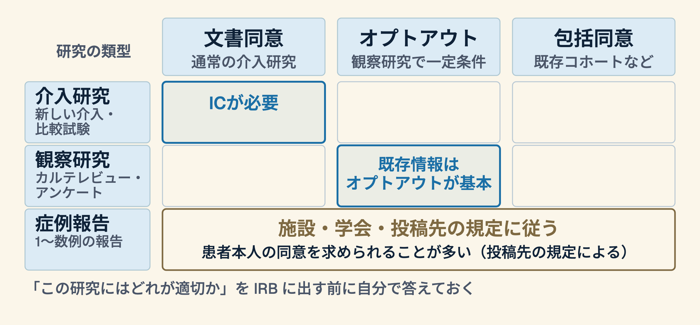

# 研究を始める前に、一度立ち止まる

## 生命科学・医学系研究倫理指針改正 (2026) と個人情報の新しい扱い

家庭医療科 勉強会 / 2026-03-27 / 15分

---

## このセッションで持ち帰ってもらう3つ

1. 今回の改正で **何が変わったか** を 1 行で説明できる
2. 自分の研究・症例報告が **どの類型に当たるか** を見分けられる
3. IRB に出す前に **見直すチェック 3 項目** を持ち帰る

> **約束**: 「倫理は難しい」ではなく「**最初に整えれば後が楽**」の話です。

---

## 0. なぜ今この話か

- 文部科学省・厚生労働省・経済産業省の **3 省庁** が指針を一部改正
- パブリックコメント: **2025年12月26日 - 2026年1月25日** に実施済み
- **2026年8月27日に告示、2026年12月1日から適用**
- 研修医の症例報告・研究発表にも直接関わる

---

## 一行でまとめると

> **個人情報の取り扱いを、2026 年時点の社会状況にアップデートする**

---

## 整理された3つの点

### 加工情報
- 仮名加工・匿名加工情報は、個人情報保護法の規定に沿って取り扱う形に整理

### 同意手続き
- 同意手続きを「IC」と「オプトアウト」の2本柱に整理

### 既存の試料・情報
- 既存の試料・情報の利用・提供は、オプトアウトを基本に

---

# Part 1. 何が変わったか

---

## 主な改正ポイント

- **個人情報取扱いの見直し** (主軸)
- 同意取得の運用整理 (包括同意・オプトアウトの条件)
- データ共有・二次利用時の手続き明確化
- 海外との共同研究時のデータ越境

---

## 研修医に関係する「3 類型」

| 類型 | 例 | 改正後の主な影響 |
|---|---|---|
| 症例報告 | 1〜数例の報告 | 施設・学会・投稿先の規定に従う |
| 観察研究 | カルテレビュー・アンケート | 既存情報はオプトアウトが基本 |
| 介入研究 | 新しい介入・比較試験 | ICが必要 |

---

## 「症例報告だから大丈夫」ではない

- 1 例でも個人が特定されうる情報が含まれる
- 画像・日付・地名が組み合わさると **簡単に特定できる**
- 学会抄録・論文投稿前に、**患者本人の同意**を求められることが多い (投稿先の規定による)
- 所属施設の IRB 運用に必ず照会する

---

# Part 2. 自分の研究をチェックする

---

## チェック① 誰のデータを、どう使うか

| 問い | 決めること |
|---|---|
| 誰の | 年齢層・疾患・受療経路を明確に |
| どこから | 自院カルテ? 多施設? |
| 何のために | 学術発表 / 二次利用 / 教材 |

1 文で書けないなら、設計がまだ固まっていない

---

## チェック② 同意はどの型か
### 研究の類型 × 同意の型

---

## チェック③ データ管理

- **加工**（匿名加工か仮名加工か）
- **媒体**（どの媒体で保管するか: 院内サーバ / クラウド / USB は原則ダメ）
- **アクセス**（誰がアクセスできるか: 研究責任者 + 分担者のリスト）
- **期間**（保管期間と廃棄方法）

---

# Part 3. 実例で考える

---

## ケース: 外来アンケート研究

> 「在宅療養中の患者の QOL 調査をしたい。カルテ情報と紐づけたい」

- 対象: 観察研究 (カルテ + アンケート)
- 同意: カルテ情報はオプトアウト + アンケート依頼はIC
- 注意: カルテ情報の範囲を事前に明記
- 改正後の要点: **オプトアウト掲示の期間と方法**を IRB と摺り合わせる

---

## ケース: 症例報告 (学会発表)

> 「稀な合併症を呈した 75 歳男性、1 例」

- 類型: 症例報告
- 同意: **本人同意を得るのが一般的** (施設・学会・投稿先の規定に従う)
- 注意: 画像・年齢・地名の組み合わせで特定されないか
- 改正後の要点: 同意の取り方は所属施設・学会・投稿先の規定を確認する

---

# Part 4. 相談窓口と動き方

---

## 迷ったら

- 所属施設の **研究倫理審査委員会 (IRB) 事務局**
- 所属学会・投稿先の倫理規定
- 厚労省「研究に関する指針について」のページ

**「大丈夫だろう」で進めない**。小さく相談する癖をつける。

---

## 今週やってみてほしい1つ

直近 3 ヶ月で発表予定のもの (症例報告・研究) を 1 つ選んで、
上の 3 チェック (誰のデータ / 同意の型 / 管理) を **紙 1 枚にまとめる**。

- 出せるか出せないかは、IRB に出す前に **紙 1 枚で見える**

---

## 持ち帰り — recap

1. 3 省庁の倫理指針改正 (2026 年12月1日適用)、主軸は **個人情報取扱いの見直し**
2. 症例報告でも個人特定リスクあり → **同意と匿名化** を最初に設計
3. 迷ったら IRB に**小さく早く**相談。「大丈夫だろう」で進めない

---

## 参考文献

### 改正情報 (一次ソース)

- 文部科学省 報道発表 (改正の告示, 2026-08-27)
  <https://www.mext.go.jp/b_menu/houdou/mext_01679.html>
- 文部科学省 パブリックコメント実施 (2025-12-26 - 2026-01-25)
  <https://www.mext.go.jp/b_menu/houdou/mext_01591.html>
- 厚生労働省 研究に関する指針について (新旧対照表・施行通知 2026-08-27)
  <https://www.mhlw.go.jp/stf/seisakunitsuite/bunya/hokabunya/kenkyujigyou/i-kenkyu/index.html>

