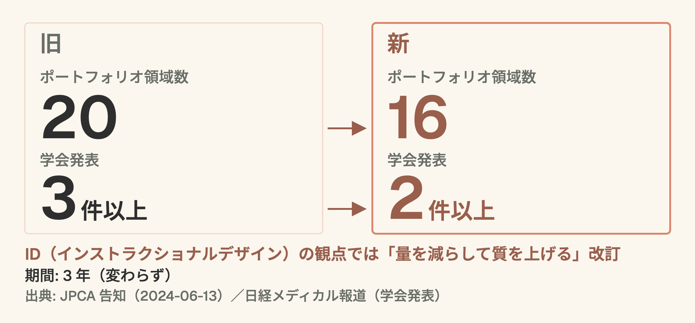

# ポートフォリオが 20 → 16 になった、何が変わるか

## 新・家庭医療専門医制度とかかりつけ医機能報告 (2026)

家庭医療科 勉強会 / 2026-03-27 / 15分

---

## このセッションで持ち帰ってもらう3つ

1. ポートフォリオの **何が減って何が残ったか** を言える
2. **学会発表要件** の緩和と学術大会の意味を理解する
3. **かかりつけ医機能報告制度** が自分の診療にどう関わるかを1つ挙げる

> **約束**: 制度の話は退屈に見えがちですが、**「自分の1年がどう変わるか」** の視点で読みます。

---

## 0. なぜ今この話か

- 新・家庭医療専門医制度で **ポートフォリオ領域数が 20 → 16 に削減** (2 割減)
- 学会発表も **3 件以上 → 2 件以上** に緩和 (日経メディカル報道)
- 第 17 回 JPCA 学術大会は **2026 年 5/29-31 に国立京都国際会館で開催済み**
- かかりつけ医機能報告制度 (2025/4 施行) の初回報告は **2026/1-3** に実施され、都道府県の公表が始まっている

---

# Part 1. ポートフォリオの変化

---

## 20 → 16、3件 → 2件

> **ポートフォリオ領域 20 → 16**
> **学会発表 3 件 → 2 件**

---

## 数字で見る
### 領域数と学会発表

---

## 何が問われているのか

- **「こなす」から「深く学ぶ」へ**
- 1 領域あたりの記述・振り返りの質が問われる
- 指導医も「印鑑を押す」ではなく「対話する」設計に
- 「ポートフォリオが形骸化していた」という現場感への応答

---

## 研修医側の影響

- 書く領域は減った → **1 本あたりのボリューム**が増える覚悟
- 学会発表は 2 本 → 何を残すかの**戦略性**が上がる
- ポートフォリオ指導は**指導医との対話時間**が鍵
- 「埋める」より「語れる」記述を目指す

---

# Part 2. 学会発表 3→2 の読み方

---

## 量より質へ

- 学会発表の**バッジ集め**から**意味のある 2 本**へ
- JPCA 本大会・地方会・英語発表のバランスを考え直す時期
- 「領域を網羅する」より「**自分の臨床疑問 1 本を深掘る**」が評価される

---

## JPCA 学術大会 2026 (京都)

- 会期: **2026 年 5/29 - 5/31** (開催済み)
- 会場: 国立京都国際会館
- テーマ: 「つながる、つなげる。つなげる、つながる。」
- 次回以降の大会も、**制度と教育の接点**を考える機会になる

---

# Part 3. かかりつけ医機能報告制度

---

## 制度の骨格

- 2025 年 4 月施行
- 医療機能情報提供制度と同じ時期 (毎年 1-3 月) に報告
- 初回報告は **2026 年 1-3 月** に実施済み
- 特定機能病院と歯科を除く全ての病院・診療所が報告
- 都道府県が結果を公表 (例: 神奈川県は 2026/10/19 公表、報告率 87.1%・2026/9/30 時点)

---

## 研修医の診療とどう繋がるか

- ✅ 慢性疾患の継続管理 → 報告指標に関わる
- ✅ 在宅医療・多職種連携 → 同上
- ✅ ACP・意思決定支援 → 価値観対話が記録に残る意味
- ❌ 「外来を回すだけ」の診療は可視化されにくい

---

## 報告指標と日々の診療

- 「どう記録されるか」を意識して書く
- カルテに**機能報告に繋がる視点**を 1 行入れる
- 「継続管理 / 在宅 / 連携 / ACP」のキーワードで自分の 1 週間を振り返る

---

# Part 4. 自分の 1 年をどう変えるか

---

## 3 つの問い

- ポートフォリオで**深く書きたい領域**はどれか?
- 学会発表 2 本は **何と何** にするか?
- かかりつけ医機能報告の指標で、**自分が強い領域**はどこか?

---

## 指導医との対話で使える一言

- 「今の記述で、**後輩が読んで学べる**ものになっているか?」
- 「この症例で **自分が一番驚いたこと** を書けているか?」
- 「もし外部評価者が読んだら、**何を疑問に思う**か?」

---

## 今週やってみてほしい1つ

ポートフォリオの**未提出領域を 1 つ**選んで、
「1 症例 × 3 行の記述」を**できそうなときに**書いてみてください。

- 3 行は「起きたこと / 自分が考えたこと / 次にどう変えるか」
- これが**指導医との対話の種**になる

---

## 持ち帰り — recap

1. 新専門医制度: ポートフォリオ **20→16**、学会発表 **3→2**。量より質へ
2. JPCA 学術大会 (2026 年 5/29-31 京都) は開催済み。次回以降も **制度と教育の接点**を考える機会
3. かかりつけ医機能報告: 自分の診療の**見え方**を変える。記録で可視化する意識

---

## 参考文献

### 学会・制度 (一次情報)

- 日本プライマリ・ケア連合学会 (JPCA) 公式
  <https://www.primarycare-japan.com/>
- JPCA: 新家庭医療専門医ポートフォリオ領域改訂のご案内 (2024-06-13, 20 → 16 領域, 2024 年度修了者から適用)
  <https://www.primarycare-japan.com/news-detail.php?nid=890>
- 日経メディカル: 専門医制度解説 (領域 20→16、学会発表 3 件以上→2 件以上)
  <https://medical.nikkeibp.co.jp/leaf/mem/pub/report/t325/202406/584715.html>

### かかりつけ医機能報告制度

- 厚生労働省 かかりつけ医機能報告制度 (ガイドライン・報告マニュアル)
  <https://www.mhlw.go.jp/stf/seisakunitsuite/bunya/0000123022_00007.html>
- 神奈川県 令和7年度かかりつけ医機能報告の公表 (2026-10-19)
  <https://www.pref.kanagawa.jp/docs/f6z/r7kakaritsuke.html>
