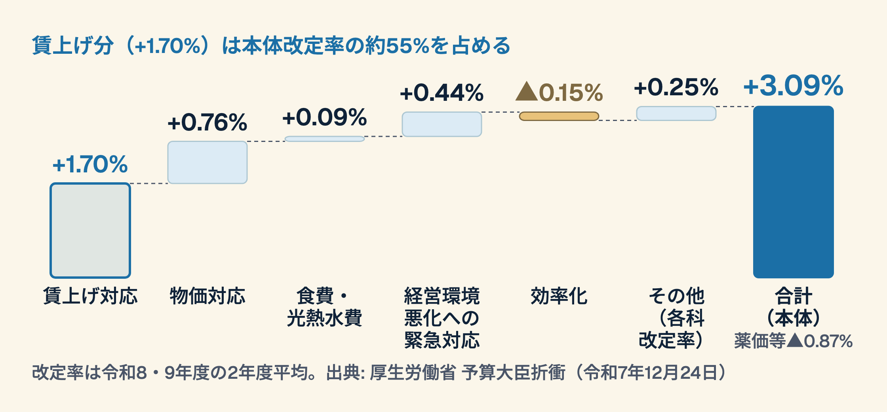
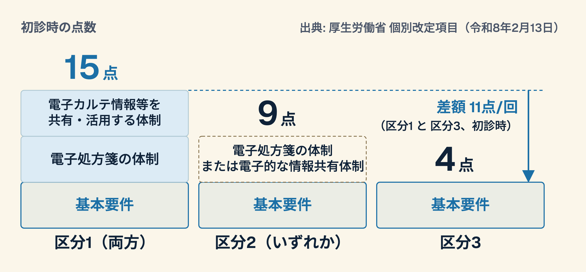

# 2026年度 診療報酬改定 — 管理者・指導医のための完全ガイド

**対象**: 指導医・管理職（診療部長、事務長、経営層）
**IDモデル**: ガニェの9教授事象
**作成日**: 2026-03-28

---

## Slide 1: タイトル
### 事象1: 注意の喚起

> **2026年度 診療報酬改定**
> 管理者・指導医のための完全ガイド

賃上げ・DX・かかりつけ・急性期再編 — 4つの柱を読み解く
---

## Slide 2: 本日の学習目標
### 事象2: 学習目標を知らせる

**今日のゴール（ブルーム分類法）**:
1. **分析できる** — 改定の構造的背景と4つの柱の相互関係を説明できる
2. **評価できる** — 自院への影響を定量的に判断できる
3. **創造できる** — 施設基準取得・維持の戦略ロードマップを立案できる

---

## Slide 3: 改定の歴史的位置づけ
### 事象3: 前提条件を思い出させる

> **本体 +3.09%**
> 3%台の本体改定は、1996年度（+3.4%）以来30年ぶり

---

## 2024年度と2026年度の本体改定率

| 年度 | 本体改定率 | 備考 |
|---|---|---|
| 2024年度 | +0.88% | |
| **2026年度** | **+3.09%** | 令和8・9年度の2年度平均。令和8年度 +2.41%、令和9年度 +3.77%。薬価等は▲0.87% |

令和8年6月施行

**問い**: なぜ今、30年ぶりの水準の引き上げが必要になったのか？
---

## Slide 4: 改定率の内訳
### 事象4: 新しい内容を提示する

| 項目 | 改定率（2年度平均） | 備考 |
|------|--------|-----------|
| 賃上げ対応 | +1.70% | 令和8年度 +1.23%・令和9年度 +2.18% |
| 物価対応 | +0.76% | 令和8年度 +0.55%・令和9年度 +0.97% |
| 食費・光熱水費 | +0.09% | 入院時の基準額引上げ |
| 経営環境悪化への緊急対応 | +0.44% | 令和6年度改定以降の悪化を踏まえた対応 |
| 効率化 | ▲0.15% | 後発医薬品への置換え、在宅医療等の適正化など |
| その他（各科改定率） | +0.25% | 医科 +0.28%・歯科 +0.31%・調剤 +0.08% |
| **合計（本体）** | **+3.09%** | 薬価等 ▲0.87% |

> 賃上げ分（+1.70%）は本体改定率の約55%を占める — これは政策的メッセージ
---

## 改定率の内訳を積み上げる
### 合計は本体 +3.09%

---

## Slide 5: 4つの柱
### 事象5: 学習の指針を与える

> **改定の4本柱**

1. **賃上げ・物価対応** — ベースアップ評価料の拡充、物価対応料新設
2. **医療DX推進** — 旧加算廃止→電子的診療情報連携に統合
3. **かかりつけ医機能強化** — 地域包括診療加算の再編、生活習慣病管理料
4. **急性期再編** — 急性期病院一般入院基本料の新設、地域包括医療病棟の6区分化
---

## Slide 6: セクション1 — 外来改定の全体像

> **外来（診療所）改定のポイント**
> 6つの主要変更を押さえる

1. 再診料の引き上げ
2. 機能強化加算 + BCP義務化
3. 地域包括診療加算の再編
4. 生活習慣病管理料の変更
5. ベースアップ評価料の拡充
6. 物価対応料の新設

---

## Slide 7: 再診料・基本診療料

> **再診料: 75点 → 76点**
> 初診料は変更なし（291点）

---

## 再診料の変更と経営インパクト

| 項目 | 旧 | 新 |
|---|---|---|
| 初診料 | 291点 | 変更なし（291点） |
| 再診料 | 75点 | 76点（+1点） |

**経営インパクト（試算）**: 1点＝10円。1日100人の外来で診療日数300日とすると年間約30万円増
---

## Slide 8: 機能強化加算とBCP義務化

> **機能強化加算: 80点（維持）**
> **ただし施設基準にBCP策定が追加**

- 経過措置: **2027年5月31日**まで（令和8年3月31日時点で届出済みの医療機関）
- BCP = Business Continuity Plan（事業継続計画）
- 災害等の発生時にも医療の提供を継続できる業務継続計画を策定し、定期的に見直す
- 経過措置の終了後は、**未策定だと施設基準を満たさない**
---

## Slide 9: 地域包括診療加算の再編

> **認知症地域包括診療加算を統合 → 地域包括診療加算1・2の中で患者区分別に評価**

| 区分 | 認知症を有する患者等 | その他の慢性疾患等 |
|------|------|---------|
| 加算1 | 38点 | 28点 |
| 加算2 | 31点 | 21点 |

- 認知症ケアの評価を地域包括診療加算に統合
- 対象患者に、脂質異常症・高血圧症・糖尿病・慢性心不全・慢性腎臓病のいずれかがあり、介護給付・予防給付を受けている方を追加
- **管理職視点**: 対象患者の拾い上げと、認知症患者の診断後支援の案内が整うかを確認
---

## Slide 10: 生活習慣病管理料

> **生活習慣病管理料の進化**

- 基本構造は維持（Ⅰ・Ⅱ）
- **新設**: 眼科医療機関連携強化加算・歯科医療機関連携強化加算（各60点、年1回）。糖尿病を主病とする患者が対象
- 療養計画書への患者の署名が不要に
- 生活習慣病管理料（Ⅰ）は、血液検査等を少なくとも6月に1回以上行うことが要件に
- **管理職視点**: 多職種・他科連携の体制整備が収益に直結
---

## Slide 11: ベースアップ評価料

> **初診時 6点 → 17点（約3倍）**

---

## ベースアップ評価料 旧制度と新制度

| 旧制度 | 新制度 |
|--------|--------|
| 主として医療に従事する職員（医師・歯科医師を除く）が対象 | **事務職員を含む、当該医療機関で勤務する幅広い職員が対象** |
| 初診時 6点・再診時等 2点 | **初診時 17点・再診時等 4点**（継続して賃上げに取り組む医療機関は 初診時23点・再診時等6点） |
| 賃上げ実績報告義務 | 賃上げ実績報告義務（継続・毎年8月に報告） |

- 令和9年6月以降は、所定点数の2倍で算定
- **注意**: 実際に賃上げに充てる必要あり（報告義務）。届出は5月中に必要
---

## Slide 12: 物価対応料（新設）

> **外来: 初診2点・再診等2点・訪問診療3点（新設）**

---

## 物価対応料の2段階

| 区分 | 令和8年6月から | 令和9年（2027年）6月以降 |
|---|---|---|
| 初診 | 2点 | 4点 |
| 再診等 | 2点 | 4点 |
| 訪問診療 | 3点 | 所定点数の2倍 |

- 2段階実施の意味: 物価動向を見ながら段階的に対応
- **管理職視点（試算）**: 1日100人・診療日数300日で、再診2点なら年間約60万円
---

## Slide 13: セクション2 — 入院改定の全体像

> **入院改定のポイント**
> 急性期再編の本丸

1. 地域包括医療病棟の6区分化
2. 急性期病院一般入院基本料の新設
3. 入院物価対応料の新設
4. 特定機能病院等紹介患者受入加算の新設
5. 救急搬送の受入実績に着目した病院機能の評価
---

## Slide 14: 地域包括医療病棟の6区分化

> **一律評価 → 入院料1・2 × 3区分の6段階**

| 区分 | 点数 | 主な要件 |
|------|------|---------|
| 地域包括医療病棟入院料1（急性期病棟の併設なし）の 入院料1／2／3 | 3,367 / 3,267 / 3,117点 | 院内に一般病棟入院基本料を算定する病棟がない |
| 地域包括医療病棟入院料2（併設あり）の 入院料1／2／3 | 3,316 / 3,216 / 3,066点 | 入院料1の併設なしの要件を満たさない |

- それぞれの入院料1／2／3は、緊急入院か予定入院か、手術の有無で分かれる
- 従来は一律3,050点
- **管理職視点**: 自院がどの区分に該当するか、早期に評価が必要
---

## Slide 15: 急性期入院料の再編

> **急性期病院一般入院基本料の新設**

- 新設: 急性期病院A一般入院料（1,930点）・急性期病院B一般入院料（1,643点）
- 救急搬送件数や全身麻酔手術件数などの病院機能が施設基準になる
- 急性期一般入院料1は 1,688点 → 1,874点に引き上げ
- **ポイント**: 自院の救急搬送・手術実績が区分の判断材料になる
---

## Slide 16: 総合診療と今回の改定

> **総合診療に着目した新設項目は、個別改定項目では確認できない**

- 今回の個別改定項目（2026-02-13）に、総合診療専門医の配置そのものを評価する新設項目は見当たらない（2026年11月時点）
- 高齢者の中等症までの救急疾患等の幅広い受入は、地域包括医療病棟の見直しで評価される
- **管理職視点**: 総合診療的な診療を担う病棟の位置づけは、地域包括医療病棟の区分と合わせて検討
---

## Slide 17: 特定機能病院等紹介患者受入加算

> **新設: 60点**

- 診療所・200床未満の病院が、特定機能病院等からの紹介患者を初診で受け入れた場合に加算
- 逆紹介の推進（大病院→診療所の流れ）
- 紹介状なし受診の抑制策と連動
- **管理職視点**: 連携パスの整備が収益に直結
---

## Slide 18: 救急搬送の受入実績と病院機能

> **救急搬送の受入実績が入院料の区分に反映**

- 急性期病院A・Bは、救急搬送件数・全身麻酔手術件数・人口の少ない地域での救急搬送受入状況などを踏まえて設定
- 介護保険施設等からの救急搬送の受入に関する要件もある
- **管理職視点**: 受入件数の把握と記録の整備が区分の維持に必要
---

## Slide 19: セクション3 — 医療DX

> **医療DX改定のキーメッセージ**
> 「体制整備」から「実績評価」へ

- 旧加算2つを廃止 → 1つに統合
- 体制があるだけでは不十分、電子資格確認の十分な実績が必要
- マイナ保険証の利用実績が要件に含まれる
---

## Slide 20: 旧制度→新制度の統合

> **電子的診療情報連携体制整備加算**

| 旧制度 | →  | 新制度 |
|--------|-----|--------|
| 医療DX推進体制整備加算 | 廃止 | 電子的診療情報連携体制整備加算 |
| 医療情報取得加算 | 廃止 | （3区分に統合） |

---

## Slide 21: 電子的診療情報連携の3区分

> **区分1（15点）→ 区分3（4点）**

| 区分 | 点数（初診時） | 要件 |
|------|------|------|
| **区分1** | **15点** | 基本要件 + 電子処方箋の体制 + 電子カルテ情報等を共有・活用する体制（両方） |
| 区分2 | 9点 | 基本要件 + 電子処方箋の体制または電子的な情報共有体制のいずれか |
| 区分3 | 4点 | 基本要件（電子資格確認の体制と十分な実績、掲示、マイナポータルを踏まえた相談体制など） |

- **差額**: 区分1 vs 区分3 = **11点/回**（初診時）
- 再診・外来診療料は、月1回 2点
---

## 区分の要件と点数
### 基本要件に積み上げるほど高い点数

---

## Slide 22: マイナ保険証の利用実績

> **電子資格確認の「十分な実績」が全区分の基本要件**

- 利用率の基準値は施設基準の通知で確認する（医療機関の掲示例では30%以上）
- **施設でできること**:
  - 受付でのマイナ保険証利用促進
  - ポスター掲示・声かけマニュアル
  - カードリーダーの動線最適化
---

## Slide 23: 電子処方箋の要件

> **電子処方箋: もはや「対応済み」が前提**

- 区分1は電子処方箋の体制が必須、区分2は電子処方箋か電子的な情報共有体制のいずれか
- 導入コスト vs 長期的な加算収入
- **管理職視点**: 未導入なら導入計画の策定を早めに
---

## Slide 24: セクション4 — BCP策定義務化

> **BCP: もう「あると良い」ではなく、経過措置後は施設基準に含まれる**

- **期限: 2027年5月31日**（経過措置）
- 機能強化加算・在宅療養支援診療所・在宅療養支援病院の施設基準に追加
---

## Slide 25: 自然災害BCP チェックリスト

> **策定項目の例（7項目）**

1. 優先業務の特定と順位付け
2. 職員参集計画（連絡網・代替手段）
3. 患者安全確保手順
4. ライフライン途絶時の対応
5. 備蓄計画（医薬品・食料・燃料）
6. 地域連携体制（受入・搬送）
7. 年1回以上の訓練実施

---

## Slide 26: サイバーセキュリティ対策

> **医療機関もサイバー攻撃の対象です**

1. バックアップ体制（3-2-1ルール）
2. ランサムウェア対策（ネットワーク分離）
3. 紙カルテ運用への切り替え手順
4. 全職員向けセキュリティ教育（年1回以上）
5. インシデント発生時の報告・対応フロー
---

## Slide 27: セクション5 — 経営戦略

> **自院への影響をどう評価するか**

- ステップ1: 現在の施設基準一覧を棚卸し
- ステップ2: 改定後の点数変動をシミュレーション
- ステップ3: 新規取得可能な施設基準を洗い出し
- ステップ4: 投資対効果（ROI）で優先順位づけ

---

## Slide 28: 施設基準 取得・維持ロードマップ

> **優先度マトリクス**

| 緊急度高 × 効果大 | 緊急度低 × 効果大 |
|:---:|:---:|
| BCP策定（期限あり） | 電子処方箋導入 |
| ベースアップ評価料申請 | 地域包括診療加算1 |

| 緊急度高 × 効果小 | 緊急度低 × 効果小 |
|:---:|:---:|
| 物価対応料の届出 | その他の加算見直し |

---

## Slide 29: 全職員への伝え方
### 事象7: フィードバックを与える

> **「改定は経営の話」で終わらせない**

- **全職員に伝えるべき3点**:
  1. ベースアップ評価料の拡充 → 「賃上げの原資になります（実績報告が必要です）」
  2. マイナ保険証利用促進 → 「受付での声かけが体制の評価につながります」
  3. BCP → 「あなたと患者を守る計画です」
- 事務部門・看護部門・リハビリ部門それぞれの伝え方を変える
---

## Slide 30: まとめ＋次のアクション
### 事象8,9: 評価 + 保持と転移

> **これから進める5つのアクション**

1. **できるときに**: 施設基準の棚卸し（現状把握）
2. **早めに**: BCP策定プロジェクトチーム発足
3. **次の機会に**: マイナ保険証利用率の現状把握と目標設定
4. **2026年6月**: 改定施行（済）— 届出・算定の状況を確認
5. **2027年5月**: BCP経過措置期限 — 完了必須

> **問い**: 自院で最もインパクトが大きい改定項目はどれか？
> 次の会議までに考えてみてください。
---

### 参考文献

1. **厚生労働省** — 令和8年度診療報酬改定について（予算大臣折衝, 令和7年12月24日）
   https://www.mhlw.go.jp/content/12401000/001620952.pdf

2. **厚生労働省** — 令和8年度診療報酬改定について（答申・告示・個別改定項目）
   https://www.mhlw.go.jp/stf/newpage_67729.html

3. **厚生労働省** — 個別改定項目について（令和8年2月13日）
   https://www.mhlw.go.jp/content/10808000/001655176.pdf

4. **厚生労働省** — ベースアップ評価料等（賃上げ）の特設ページ
   https://www.mhlw.go.jp/stf/seisakunitsuite/bunya/0000188411_00053.html

5. **日本医師会** — 令和8年度診療報酬改定 改定率は本体プラス3.09％に決定
   https://www.med.or.jp/nichiionline/article/012551.html

6. **共同通信（熊本日日新聞）** — 診療報酬「本体」3・09%上げ 政府、30年ぶり高水準
   https://kumanichi.com/articles/1938489

---
