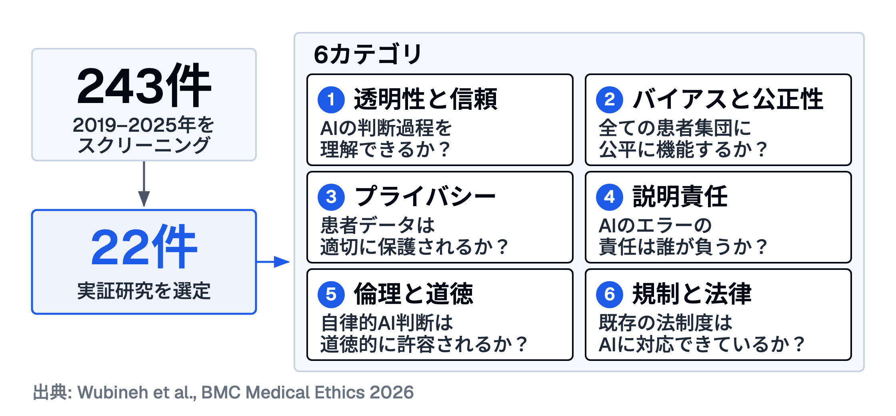
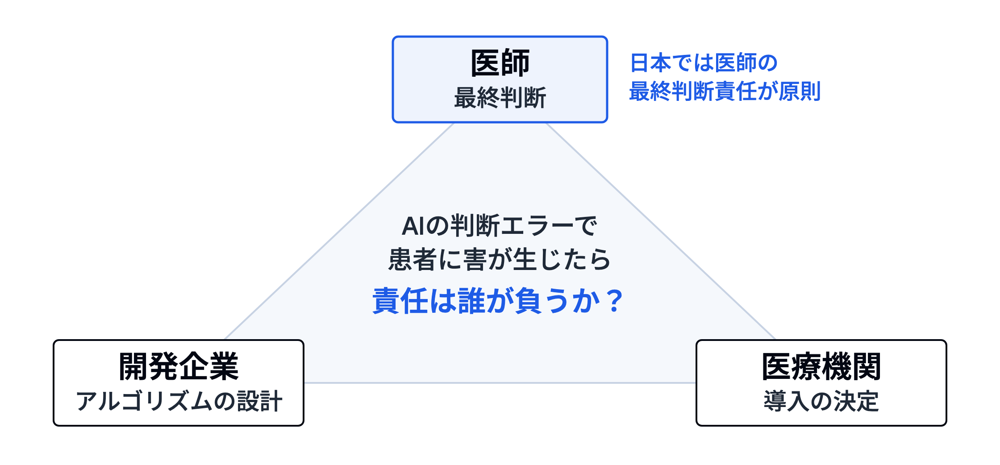

# 医療AIの倫理的懸念と実装戦略
## 研修医・専攻医向けスライド（15分）

---

> **対象**: 研修医・専攻医
> **時間**: 15分
> **IDモデル**: ガニェの9教授事象
> **ブルーム到達目標**: 理解 → 分析 → 創造
> **ソース**: Wubineh BZ, Deriba FG, Gemeda FW. BMC Medical Ethics. 2026;27:53.

---

## スライド 1: 問いの投げかけ
### 「この患者、敗血症リスク"高"です」— AIがそう言ったら？

<!-- ガニェ事象1: 学習者の注意を喚起する -->

**シナリオ**:
深夜の救急外来。38.5度の発熱と頻脈で搬送された72歳女性。
AIシステムが「敗血症リスク: 高（92%）」とアラート（数字は議論のための架空の設定で、実在の製品の性能ではない）。

しかし、あなたの臨床的印象は「単純性尿路感染症」。

**問い**: あなたはAIの判断をどう扱いますか？

---

## スライド 2: 今日のゴール
### この15分で手に入れるもの

<!-- ガニェ事象2: 学習目標を知らせる -->

1. **説明できる**: 医療AIの倫理的懸念を6つのカテゴリで構造的に整理できる
2. **分析できる**: 臨床シナリオにおけるAI判断のバイアス源を特定できる
3. **計画できる**: AIの推奨と自身の臨床判断を統合するプロセスを言語化できる

---

## スライド 3: あなたがすでに知っていること
### 臨床倫理の4原則を思い出そう

<!-- ガニェ事象3: 前提条件を思い出させる -->

バイオエシックスの4原則（Beauchamp & Childress）:

| 原則 | 内容 | AIとの接点は？ |
|------|------|----------------|
| 自律尊重（Autonomy） | 患者の意思決定を尊重 | AIが推奨→患者の選択はどうなる？ |
| 善行（Beneficence） | 患者に最善を尽くす | AIの精度が人間を超えたら？ |
| 無危害（Non-maleficence） | 害を与えない | AIの誤判断で害が生じたら？ |
| 正義（Justice） | 公平・公正 | AIが特定集団で精度低下したら？ |

**ポイント**: この4原則をAI文脈に「再解釈」する必要がある — それが今日のテーマ。

---

## スライド 4: 6つの倫理的懸念カテゴリ
### システマティックレビューが体系化した全体像

---

## スライド 5: カテゴリ深掘り (1) 透明性と信頼
### ブラックボックス問題

<!-- ガニェ事象5: 学習の指針を与える -->

**問題の核心**: 深層学習モデルは「なぜその判断をしたか」を説明できない

- **ブラックボックス**: 入力→出力は分かるが、中間の推論過程が不透明
- **XAI（Explainable AI / 説明可能AI）**: 判断根拠を可視化する技術（例: SHAP、LIME）
  - しかし、XAIの「説明」は人間の「理解」と同義ではない
- **臨床的含意**: 「AIがそう言っているから」では患者への説明責任を果たせない

**批判的吟味の視点**: あなたが使うAIツールは、判断の根拠を示してくれるか？

---

## スライド 6: カテゴリ深掘り (2) バイアスと公正性
### 3層のバイアス構造

**バイアスは3つの層で発生する**:

| 層 | 内容 | 具体例 |
|----|------|--------|
| **データバイアス** | 訓練データの偏り | 白人肌データ中心→有色人種で皮膚がんAI精度低下 |
| **アルゴリズムバイアス** | 特徴量選択の暗黙の仮定 | 人種を代理変数として使用 |
| **システムバイアス** | 医療制度の歴史的不平等の再生産 | 受診率が低い集団のデータが少ない→さらにケア格差拡大 |

**Fairness Impossibility Theorem（不可能性定理）**:
公正性の複数指標（Demographic Parity, Equalized Odds, Predictive Parity）を**同時に全て満たすことは数学的に不可能**。
どの指標を優先するかは**倫理的判断**であり、技術的判断ではない。

---

## スライド 7: カテゴリ深掘り (3) 説明責任と規制
### 責任の三角形

---

## 説明責任と規制 — 現状と課題

- 現状: 日本では医師の最終判断責任が原則
- 課題: AIが「推奨」し医師が「承認」するだけの運用になった場合は？
- EU AI法: 医療機器に組み込まれる高リスクAIに技術文書・人間の監視などを義務化（2026年7月の改正で適用は2028年8月に延期）

---

## スライド 8: ペアディスカッション
### 冒頭のシナリオに戻ろう

<!-- ガニェ事象6: 練習の機会を設ける -->

**シナリオの再提示**:
AIが「敗血症リスク: 高（92%）」→ あなたの印象は「単純性UTI」

**ペアで3分間ディスカッション**（6つのカテゴリをフレームワークとして使う）:

1. このAIシステムの**透明性**はどうか？（92%の根拠は見えるか？）
2. この患者に特有の**バイアス**リスクはないか？（年齢、性別、併存疾患）
3. AIの判断を採用/不採用にした場合、**説明責任**はどこにあるか？
4. 「AIを**使わない**ことの倫理的責任」はあるか？

---

## スライド 9: 共有と振り返り
### 全体共有 + ファシリテーターコメント

<!-- ガニェ事象7: フィードバックを与える -->

**共有のポイント**:
- 各ペアから1つずつ意見を共有（30秒×数ペア）
- ファシリテーターが6カテゴリへのマッピングを補足

**重要なメッセージ**:
> AIは「第二の意見」であり、「最終判断」ではない。
> しかし、AIの指摘を無視する場合にも、その根拠を言語化する責任がある。

---

## スライド 10: レビューの4つの提言
### 実装戦略として何が推奨されているか

<!-- ガニェ事象8: 学習の成果を評価する -->

Wubineh et al.の提言:

1. **倫理原則・基準の遵守** — バイオエシックス4原則をAI文脈に再解釈
2. **透明性の確保** — XAI手法の実装、意思決定プロセスの可視化
3. **継続的な監視・監査** — デプロイ後のバイアスモニタリング、パフォーマンスドリフト検出
4. **多職種ステークホルダー参加のガバナンス** — 開発者・臨床医・患者・倫理学者・規制当局の協働

**振り返りの問い**: あなたの病院でAI導入を検討するとき、この4つのうちどれが最も不足しているか？

---

## スライド 11: 持ち帰りの問い
### 明日からの臨床で

<!-- ガニェ事象9: 保持と転移を促進する -->

**3つの持ち帰りの問い**:

1. 今日使ったAIツール（UpToDate、画像診断AI等）の判断根拠を、患者に説明できるか？
2. そのツールの訓練データに、目の前の患者と同じ集団は含まれているか？
3. AIの推奨と自分の判断が食い違ったとき、どちらを選ぶかの「思考プロセス」を言語化できるか？

---

## 参考文献

- Wubineh BZ, Deriba FG, Gemeda FW. Ethical concerns and strategies for implementing artificial intelligence in healthcare: a review of empirical studies. *BMC Medical Ethics*. 2026;27:53. https://doi.org/10.1186/s12910-026-01404-8
- Harvard Gazette. AI is speeding into healthcare — who should regulate it? 2026. https://news.harvard.edu/gazette/story/2026/01/ai-is-speeding-into-healthcare-who-should-regulate-it/
- WHO. Ethics and governance of artificial intelligence for health: guidance on large multi-modal models. 2024. https://www.who.int/publications/i/item/9789240084759
- Regulation (EU) 2026/1744 (Digital Omnibus on AI), OJ L, 24.7.2026. https://eur-lex.europa.eu/eli/reg/2026/1744/oj
- Regulation (EU) 2024/1689 (Artificial Intelligence Act). https://eur-lex.europa.eu/eli/reg/2024/1689/oj
- JYI. Bias in Medical AI: Algorithmic Fairness and Ethics Challenges. 2026. https://www.jyi.org/2026-january-1/2026/1/8/bias-in-medical-ai-algorithmic-fairness-and-ethics-challenges

---

*Scribe generated: 2026-03-29 | Source: item-008 | ID model: ガニェの9教授事象*
