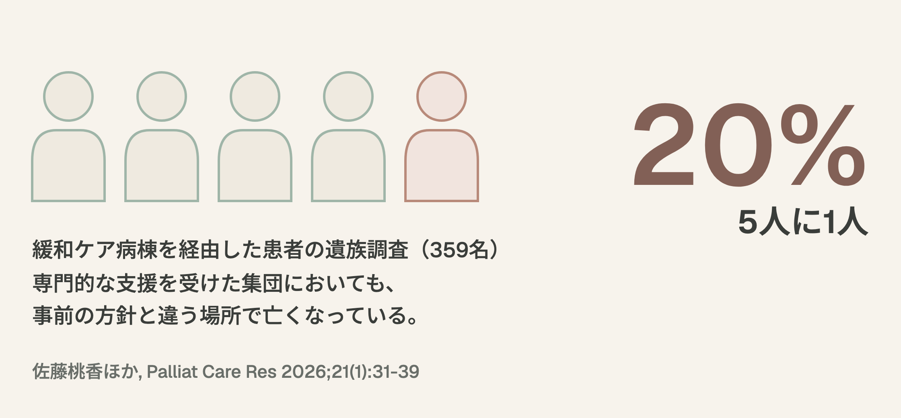
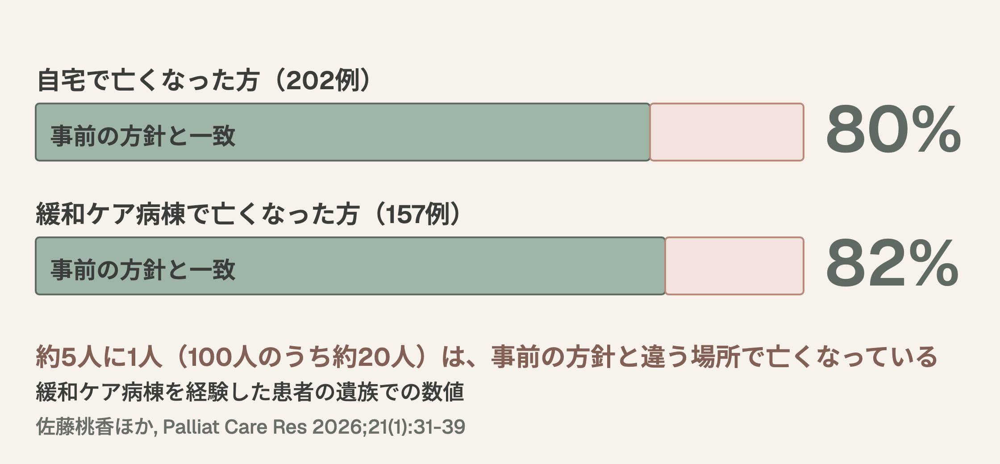

# 在宅看取り場所一致率 — 研修医・専攻医向けスライド（20分）

> IDモデル: ガニェの9教授事象 | ブルーム: 理解→分析→創造
> パレット: ダーク学術トーン（Deep Teal + Amber）
> 元データ: item-008 Deep Dive — 佐藤桃香ほか, Palliative Care Research 21(1), 2026

---

## スライド1: 注意喚起 [ガニェ事象1: 注意の獲得]

**タイトル**: 「5人に1人は、事前の方針と違う場所で亡くなっている」

- 緩和ケア病棟を経由した患者——専門的な支援を受けた集団においても
- 遺族調査359名のデータが示す現実
- 「ACPをやれば大丈夫」かどうか、一緒に考える

> ダーク背景 / 数字「20%」を大きく表示 / 問いかけ: 「あなたが担当した患者さんは、希望通りの場所で最期を迎えられましたか？」

---

## 5人に1人の数字

---

## スライド2: 学習目標の提示 [ガニェ事象2: 学習目標の提示]

**タイトル**: 今日の学習目標

1. **解釈**: ACPの看取り場所一致率データを海外研究との比較の限界も踏まえて解釈できる
2. **分析**: 不一致が生じる構造的要因を3つ以上挙げ、因果関係を分析できる
3. **創造**: 在宅看取りの意思決定支援計画を自分の臨床に合わせて立案できる

> ブルーム分類: 理解→分析→創造の3段階を明示

---

## スライド3: 前提知識の確認 [ガニェ事象3: 前提条件の確認]

**タイトル**: ACP（Advance Care Planning）の基本概念の復習

- **ACP（アドバンス・ケア・プランニング）**: 本人を中心に、家族・近しい人・医療ケアチームが繰り返し話し合い、将来の医療・ケアについての本人の意思決定を支援するプロセス（日本版ACP定義）
- **AD（Advance Directive / 事前指示書）**: 意思決定能力喪失時の法的文書 ≠ ACP
- **看取り場所の一致率（place-of-death congruence）**: 事前に合意された看取り場所と実際の死亡場所が一致した割合
- 「人生会議」は2018年に愛称が決まったが、厚生労働省の令和4年度意識調査（2023年12月公表）では、一般国民の72.1%が「知らない」、「よく知っている」は5.9%（医師は45.9%）

> ACPは「紙」ではなく「プロセス」であることを強調

---

## スライド4: 研究デザインの紹介 [ガニェ事象4: 新しい内容の提示]

**タイトル**: 本研究のデザインと対象

- **著者**: 佐藤桃香ほか（東北大学大学院 緩和ケア看護学分野）
- **デザイン**: 2018年に実施された多施設遺族調査の付帯研究（遺族への後ろ向きの回答）
- **対象**: ホスピス・緩和ケア病棟から自宅退院を経験し、その後自宅または緩和ケア病棟で死亡した終末期がん患者の遺族359名
  - 自宅死亡患者の遺族: 202名
  - 緩和ケア病棟死亡患者の遺族: 157名
- **測定**: 看取り方針（事前合意）と実際の看取り場所の一致・不一致 + 不一致理由

> メソドロジーの限界: 想起バイアス、生存者バイアス、選択バイアスに留意

---

## スライド5: 主要知見 [ガニェ事象4: 新しい内容の提示（続）]

**タイトル**: 一致率80-82% — この数字をどう読むか

| 看取り場所 | 方針との一致率 | 対象数 |
|------------|---------------|--------|
| 自宅死亡 | **80%** | 202例 |
| 緩和ケア病棟死亡 | **82%** | 157例 |

- 約80%が方針と一致していた、という読み方ができる
- 同時に「5人に1人は方針と異なる場所で亡くなっている」ことも意味する
- 緩和ケア病棟を経験した患者の遺族での数値であり、一般の在宅患者にそのまま当てはまるとは限らない

---

## 一致率80%と82%

---

## スライド6: 国際比較 [ガニェ事象4: 新しい内容の提示（続）]

**タイトル**: 海外の系統的レビューとの比較

- **レビュー**: García-Sanjuán et al., Front Psychol 2022（2010〜2021年の30研究）
- 看取り場所の一致率は研究によって21%〜100%と極めて大きなばらつき
- 一致の定義（希望・方針・事前の合意）も対象集団も研究ごとに異なる
- 本研究の80-82%を、これらの数字と単純に並べて優劣を言うことはできない

> 読み方: 「緩和ケア病棟を経験した患者」という母集団特性 — 専門的ケアへのアクセスが背景にある可能性。単一の遺族調査であり、回収・想起のバイアスも残る

---

## スライド7: 不一致要因の深層分析 [ガニェ事象5: 学習の案内]

**タイトル**: なぜ不一致が起きるのか — 構造的要因の分析

### 緩和ケア病棟方針 → 自宅看取りに至った22例（ポジティブな変更）
- 最多理由:「在宅看取りに対応する医師・看護師がいた」
- 在宅資源の発見により「より本人の希望に近い」方向への変化

### 自宅方針 → 緩和ケア病棟看取りに至った11例（ネガティブな変更）
- 最多理由:「自宅での痛み管理が不十分だった」
- 在宅医療の質的限界が直接的原因

### 構造的要因（3層）
1. **医師偏在**: 厚生労働省の試算では、診療所医師が80歳で引退し承継・新規開業がないと仮定すると、2040年に診療所のない市区町村が約170増える見込み。24時間対応の壁
2. **痛み管理格差**: 在宅ではオピオイド持続皮下注射等の専門スキル不足。家族の介護負担限界
3. **教育格差**: 学会員528名への調査（川島ほか 2026）で、介護従事者向けの地域教育活動を行っていたのは約1割。調査の定義に沿ったアウトリーチは約9.3%と推定

---

## スライド8: ケースディスカッション1 [ガニェ事象6: 練習の実施 / 事象7: フィードバック]

**タイトル**: ケース: 「自宅で最期まで」が叶わなかったAさん

### 症例提示
- 70代男性、進行膵がん。緩和ケア病棟で症状安定後、ACPで「自宅で最期を」と合意し退院
- 退院2週間後、夜間の突然の激しい腹痛。妻がパニックで119番通報
- 救急搬送→緩和ケア病棟に再入院→5日後に病棟で死亡

### ディスカッション（ペアまたは3人グループ、3分）
1. このケースで不一致を防げたポイントはどこか？
2. 退院前に、どのような「仕組み」があればよかったか？
3. 家族（妻）にどのような事前準備ができたか？

---

## スライド9: ケースディスカッション2 — トランジション設計 [ガニェ事象6: 練習（続）]

**タイトル**: Phase 1-4のトランジション設計で何ができたか？

| Phase | タイミング | Aさんのケースでの具体策 |
|-------|-----------|----------------------|
| 1 | 入院後72時間以内 | ACP開始、在宅資源アセスメント |
| 2 | 在宅準備期 | 家族への疼痛管理教育、レスキュー薬の事前配置、24時間連絡先の確認 |
| 3 | 退院後48時間以内 | 訪問診療医初回訪問、家族の不安への対応 |
| 4 | 在宅療養期 | 定期的な方針再確認、バックアップベッドの確保 |

> 核心メッセージ: ACPは「一度やれば終わり」ではなく、トランジションごとに再確認・再調整するプロセス

---

## スライド10: 振り返り＋持ち帰りの問い [ガニェ事象8: 学習成果の評価 / 事象9: 保持と転移]

**タイトル**: 振り返りと、明日からの臨床への問い

### 今日の3つの学び
1. 一致率は80-82%だが、「5人に1人」の不一致の背景には構造的課題がある
2. 不一致は「医師偏在」「痛み管理格差」「教育格差」の3層で生じている
3. ACPは「紙の文書」ではなく「繰り返しの対話プロセス」として機能させる

### 持ち帰りの問い
- 「あなたの診療圏で、在宅看取りを阻んでいる最大の構造的障壁は何ですか？」
- 「次に看取りに関わるとき、ACPの再確認をどのタイミングで行いますか？」

> 参考: 佐藤桃香ほか, Palliat Care Res 2026;21(1):31-39 / García-Sanjuán S et al., Front Psychol 2022;12:807869

---

## メタ情報

- **対象**: 研修医・専攻医
- **所要時間**: 20分
- **IDモデル**: ガニェの9教授事象
- **ブルーム分類**: 理解→分析→創造
- **トーン**: ダーク学術（Dark academic）
- **一次ソース**: 佐藤桃香ほか, Palliative Care Research 21(1):31-39
- **生成日**: 2026-03-30
- **生成者**: Scribe Agent, AI Agent Team
