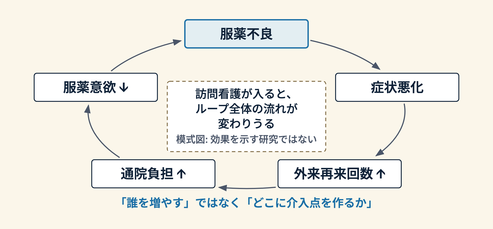

# 保健人材を「エコシステム」として見る

## WHO 2026 が示す、線形思考から全体論へ

家庭医療科 勉強会 / 2026-04-01 / 15分

---

## このセッションで持ち帰ってもらう3つ

1. WHO/NHS England のウェビナーが示した **システム思考の視点** を 1 行で説明できる
2. 目の前の多職種連携ケースを **エコシステム** の視点で眺められる
3. 自分の外来の困り事で **レバレッジポイント** を 1 つ特定できる

> **約束**: 「システム思考は難しい」ではなく、**すでにやっていることに名前をつける**時間です。

---

## 0. なぜ今この話か

- 2026 年 1 月 27 日、**WHO × NHS England** が共催ウェビナー
- テーマ: *Embracing Complexity — Systems Thinking for Health Workforce Strengthening*
- 2026 年の Working for Health 2030 ウェビナーシリーズの第 1 回
- 開催案内では、保健人材を **コミュニティ・教育・技術・財政・リーダーシップ** を含む広いエコシステムの中で捉えることを掲げている

---

# Part 1. なぜ線形思考では解けないのか

---

## 現代医療が抱える「複雑性」

- 多職種連携 (医師・看護・ケアマネ・MSW・薬剤師・リハ)
- 複数慢性疾患を持つ高齢者
- 人口動態の急変 (地域差が大きい)
- **どれも "1 つの原因 → 1 つの対策" では動かない**

---

## 線形思考の限界

- ❌ 「医師が足りない → 医師を増やせばよい」
- ❌ 「在院日数が長い → 退院を早める」
- どちらも**別の場所で歪みが噴き出す**
- サイロで解くと、エコシステム全体で悪化することがある

---

## WHO/AHPSR が整理した「枠組みの転換」

> **部品（bricks）から関係（relationships）へ**

AHPSR が 2009 年の報告書の意義として整理した 3 つの転換の 1 つ（残りは「管理から学習へ」「結果だけの評価から、文脈と過程の説明へ」）。
保健システムを構成要素の足し算でなく、**繋がりの全体**として見る。家庭医の外来そのものが、この小さな実践の場。

---

# Part 2. 3 つの核心概念

---

## ① フィードバックループ

- ある変化が **循環的に**別の変化を生む関係
- 例: 待ち時間 ↑ → 患者満足 ↓ → キャンセル ↑ → 慢性疾患管理 ↓ → 再来院 ↑
- **「点ではなく輪で」**見直すと、打ち手が変わる

---

## ② 創発 (Emergence)

- 個々の部品を足し合わせても説明できない、**全体の振る舞い**
- 多職種チームの価値は、各職種の仕事の総和以上
- **「良いチームの雰囲気」** は、設計しないと生まれない

---

## ③ レバレッジポイント (Donella Meadows)

- **小さく押すと、大きく動く場所**
- 例（仮の例）: 予約枠のルールを 1 つ変えると、外来全体の流れが変わりうる
- どこを押すか見立てる力 = 家庭医のシステム眼

---

# Part 3. 自分の外来で使う

---

## 実例（模式図）: 独居高齢者の服薬不良

---

## レバレッジポイントを見つける 3 つの問い

- 「どこを**小さく**変えたら、一番大きく動きそうか?」
- 「この問題は**誰の問題**か? (医師1人の問題にしていないか)」
- 「1 周回って戻ってくる線はどこか?」

---

## 今週やってみてほしい1つ

外来で困っているケースを 1 つ選んで、**紙に** 因果ループを描いてみる。

- 中央に患者、周囲に関係者と環境
- 矢印で「何が何に効くか」を書き込む
- 1 周回る線を探す — それがあなたの**レバレッジポイントの候補**

---

## 持ち帰り — recap

1. WHO 2026 ウェビナーの視点: 保健人材は **エコシステム**の中にある。部品ではなく関係を見る
2. 3 つの核心: **フィードバック / 創発 / レバレッジポイント**
3. 明日の外来: 困り事を紙に描き、**1 周回る線**を探す

---

## 参考文献

WHO (2026). Embracing Complexity: Systems Thinking for Health Workforce Strengthening. ウェビナー開催案内（2026-01-27 開催）
https://www.who.int/news-room/events/detail/2026/01/27/default-calendar/embracing-complexity--systems-thinking-for-health-workforce-strengthening

AHPSR (2026). Systems thinking for health systems strengthening — changing the frame.
https://ahpsr.who.int/newsroom/news/item/02-02-2026-systems-thinking-for-health-systems-strengthening-changing-the-frame

de Savigny D, Adam T, eds. (2009). Systems thinking for health systems strengthening. WHO/AHPSR.

Meadows DH (2008). Thinking in Systems: A Primer. Chelsea Green Publishing.

Plsek PE, Greenhalgh T (2001). Complexity science: The challenge of complexity in health care. BMJ 323(7313):625-628.
