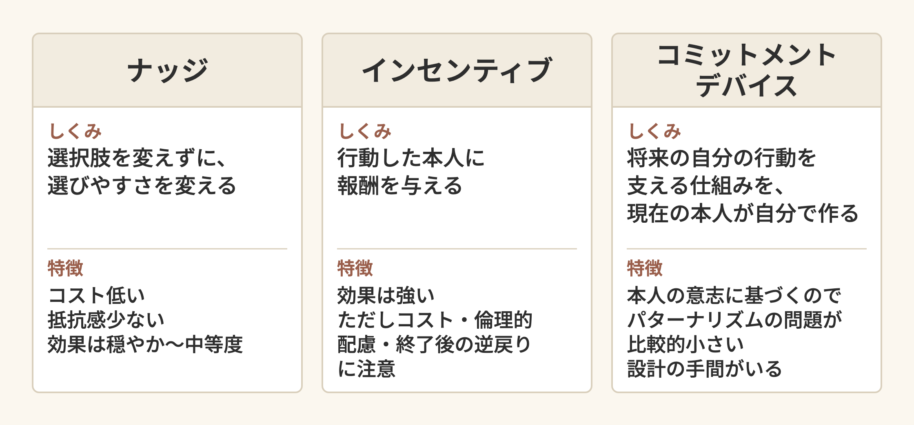

# 行動経済学で支えるメンタルヘルス診療
## ナッジ・インセンティブ・コミットメントデバイス — 説教から設計へ

家庭医療科 勉強会 / 2026-04-09 / 20分

---

## このセッションで持ち帰ってもらう3つ

1. 「分かっていてもやめられない」を **脳の報酬処理の特徴(仮説を含む)** として説明できる
2. ナッジ / インセンティブ / コミットメントデバイス の **使い分けの軸** を持つ
3. 自分の外来導線を **行動設計の対象** として眺められる視点

> **約束**: 今日の話は、明日の外来で1人の患者にかける一言から始まります。
> 後半に進むにつれて、外来の壁紙やリマインダー文言まで話が広がりますが、置いていきません。

---

## 0. なぜ今この話?

- 2025年、Iran J Psychiatry 誌の叙述的レビューが 「メンタルヘルスへの行動経済学・神経経済学の応用」 を整理
- うつ病・依存症・不安症は、それぞれ別物のように語られてきた
- 一方で、**報酬処理の異常** は複数の精神疾患にまたがる特徴と考えられるようになってきた(=transdiagnostic、まだ仮説を含む)
- ペンシルベニア大学には **Penn Medicine Nudge Unit** があり、同ユニット自身は「医療システムに組み込まれた世界初の行動デザインチーム」と紹介している(2016年発足)
- 「説教」では行動は変わらない、というのは我々が薄々知っていたこと。行動経済学は、その **設計の手がかり** をくれる
- 出典: Abdullaeva BS ら, Applications of Behavioral Economics and Neuroeconomics in Mental Health, *Iran J Psychiatry* 2025;20(1):93-101

---

# Part 1. 症例から入る

---

## 症例: 38歳女性、うつ病、抗うつ薬治療中

- 大うつ病性障害、SSRI内服中、半年経過
- 「最近どうですか?」→「変わらないです……」
- 「お薬は飲めてますか?」→「……たまに忘れます」
- 「散歩、続いてますか?」→「先生が言ってたから、やろうと思ってるんですけど……」
- 「ジムの体験予約、行けました?」→「ネットで予約まではしたんですけど、当日になると……」

**この人は、怠けているのか?**

> 30秒、隣の人と話してみてください。

---

## 「分かっていてもやめられない/始められない」の正体

「やるべきだと分かっている」と「実際にやる」の間には、巨大な溝がある。
そして、うつ病・依存症・不安症の患者では **その溝が、脳の報酬処理の特徴と関係していると考えられている**(仮説段階)。

- 腹側線条体・前頭前野 — 報酬回路の中心
- 「将来の報酬」を **小さく見積もる** バイアス(双曲割引)が、依存症などで強いと報告されている
- **将来の散歩の気分の良さ < 今ベッドにいる安心感**

これは「意志の弱さ」だけでは説明できない。**脳の報酬処理の働き方が違う可能性がある。**

---

## "怠惰" だけでなく "報酬処理の連続体" という見方

| 病名 | 報告されている報酬処理の特徴(仮説を含む) |
|---|---|
| うつ病 | 報酬への期待感の低下、努力に対する報酬感度の低下 |
| 依存症 | 即時報酬への過大評価、長期コストの過小評価 |
| 不安症 | 将来の損失への過剰な重み付け、回避行動の強化(仮説的な整理) |

> 違う病名のように見えても、報酬処理(腹側線条体・前頭前野などの回路)の変化が **複数の疾患にまたがる特徴** として注目されている。ただし、病名ごとの違いは残り、因果関係は確立していない。
> RDoC(米国NIMHの研究領域分類) では Positive Valence Systems(報酬に関わる領域)として整理されている。

---

# Part 2. 概念整理 — 3つの介入

---

## 介入1: ナッジ (Nudge)

- **選択肢を変えずに、選びやすさを変える**
- 強制ではない。インセンティブも与えない。設計だけを変える
- 例: カフェテリアで健康的な選択肢を目線の高さに置く(レビューが挙げる例)
- 医療例: 電子カルテの処方のデフォルトを後発薬にすると、後発薬の処方率が上がった(Patel ら, JAMA Intern Med 2016)

特徴: **コスト低い、抵抗感少ない、効果は穏やか〜中等度**

---

## 介入2: インセンティブ (Incentive)

- **行動した本人に報酬を与える**(金銭・ポイント・特典)
- 例: 通院・面接への参加や断酒の継続に対して、金銭的な報酬を渡す(レビューが挙げる例)
- 理論上のねらい: 即時報酬で双曲割引のバイアスを逆手に取る

特徴: **効果は強い、ただしコスト・倫理的配慮・終了後の reversion(逆戻り)に注意**

---

## 介入3: コミットメントデバイス (Commitment Device)

- **将来の自分の行動を支える仕組みを、現在の本人が自分で作る**
- 例: 面接を休んだら、本人が選んだ団体に寄付する約束を自分で決めておく(レビューが挙げる例)
- 例(案): 病院予約を "自動再予約" にする(キャンセルにアクションが要る)
- 理論上のねらい: 「今の自分」の決意を、「将来の自分」の行動に結びつける

特徴: **本人の意志に基づくのでパターナリズムの問題が比較的小さい、設計の手間がいる**

---

## 3つの介入を比べる

---

## 3つを使い分けるデシジョンツリー

| 問い | 答え | 向く介入 |
|---|---|---|
| Q1. 患者本人が「変えたい」と言っている? | NO | ナッジから(本人の選択肢は狭めない設計) |
| Q1 が YES → Q2. 自制心のサポートが必要そう? | NO | インセンティブ(短期決戦) |
| Q1 が YES → Q2. 自制心のサポートが必要そう? | YES | コミットメントデバイス(本人主導の約束) |

> もちろん組み合わせOK。
> 「ナッジで導線を整え、コミットメントデバイスで本人の約束を支える」は、よく組み合わせられる形。

---

## さっきの症例に当てはめると

| 介入 | この症例での実装案 |
|---|---|
| **ナッジ** | 服薬管理アプリのリマインダー時刻を「夕食の時間」にデフォルト設定。散歩は「玄関に靴を出しておく」だけのワーク |
| **インセンティブ** | 「次回までに散歩を5回できたら、自分で何か小さなご褒美を決めておく」と一緒に決める |
| **コミットメントデバイス** | 「次回外来日を今ここで一緒に予約する。私と看護師さんで覚えておく」=スケジュールの外部化 |

---

# Part 3. 自分の診療への適用

---

## 明日の外来で1つだけ試せること

説教モードの一言を、設計モードの一言に置き換えてみる:

| 説教モード | 設計モード |
|---|---|
| 「散歩、続けてくださいね」 | 「次の散歩の前に何を準備しておいたら一番楽になりそうですか?」 |
| 「お薬、ちゃんと飲んでくださいね」 | 「飲み忘れる時って、どんな時ですか? その時間帯のリマインダー、一緒に決めましょう」 |
| 「禁煙、頑張ってくださいね」 | 「次に吸いたくなったら、その代わりに3分だけ別のことをするとしたら、何をしたいですか?」 |

---

## 言葉のフレーミングを変える

「やってないんですね」 → 「今は、それをやるエネルギーが必要な状態じゃないんですね」

これは責任を回避する言い方ではない。
「怠惰」フレームから「報酬処理」フレームへの言い換え(仮説として)で、患者は自分を責めずに次の一歩を考えやすくなる。

> 報酬処理の偏りは **脳の状態に関わるもの** で、人格の問題ではない。患者にも、断定せずに伝えていい。

---

## 自分の外来でのふりかえり(30秒)

外来終わりに30秒、こう問う:

1. 今日、説教モードに **流されかけた瞬間** はなかったか?
2. その時、設計モードならどう声をかけられたか?
3. 患者の生活の中の "次の一歩のハードル" は、どこに下げられそうか?

メモは要らない。考える習慣だけでいい。

---

# Part 4. 次の半径へ — 外来導線という "見えないナッジ"

---

## あなたの外来は、すでにナッジ設計されている(良くも悪くも)

- 待合室の椅子の配置 → 患者同士の距離感
- 問診票の質問順 → 何を最初に話してもらうか
- 検査結果の表示順 → 何に注目させるか
- 予約システムのデフォルト → 通院頻度を決めている

> 「どうデザインするか」を意識しないとき、それは "たまたまそうなっているデザイン" になっている。
> ナッジ設計とは、その "たまたま" を **意図的に** することにすぎない。

---

## 外来導線で「ちょっと触る」レベルの工夫

- 受付の問診票に「今日一番話したいこと」を1行書ける欄を追加
- 電子カルテのテンプレに「次回までの宿題」欄を作る(処方→学習への自分用ナッジ)
- 検査結果説明で「数値」を見せる前に「前回からの間に何がありましたか?」を聞く順番に
- 待合のポスターを「禁煙してください」から「次に吸いたくなった時のための作戦を1つ持っていますか?」に変える

> どれも今日明日で全部やる必要はない。
> 「これは自分が将来触れる場所だ」と思って外来を歩くと、見え方が変わる。

---

# Part 5. 自院・地域に持ち帰る — 診療デザイナーとしての医師

---

## Penn Medicine Nudge Unit という存在

- ペンシルベニア大学の医療システム内に置かれた、行動デザインのチーム
- 院内のさまざまな導線を「行動設計の対象」として捉え、無作為化試験などで検証している
- 例: 処方デフォルトを後発薬にしたら後発薬の処方率が上がった(Patel 2016)。同ユニットは2016〜2021年に100件超のプロジェクト、25件超の無作為化試験を行ったと自ら公表している
- 参考: 接種案内に日時を書き込む欄を足すと接種率が上がった(Milkman ら, PNAS 2011、企業従業員の無作為化試験)

> 重要なのは「医療機関の中に行動設計チームが組み込まれている」という事実そのもの。
> 「医療は科学だが、その科学を **誰かに届ける** ところは設計の問題」、と組織が宣言している。

---

## 我々がそこから持ち帰れるもの

すぐにNudge Unitを作れなくても:

- 「うちの外来のここが患者の選択を歪めている」を1つ言語化してみる
- 多職種カンファで「行動設計の話」を1スライド入れてみる
- 「説教ではなく設計」という共通言語を、看護師・薬剤師・MSWと共有してみる

> 医師は治療者であると同時に、**患者の生活と医療システムを繋ぐ "設計者"** でもある。
> この役割は、訓練すれば誰でも身につけられる。

---

## 今後の課題(論文の結論より)

レビューが述べていること:

- 介入が効く **作用機序の解明** がまだ必要
- 介入の **最適化** と、患者ごとの個別化が今後の課題
- 自律性など **倫理面の検討** が欠かせない
- 神経マーカーによる治療反応・再発リスクの予測は、有望だが研究段階

家庭医療・総合診療は、患者の生活全体を見ているという点で、行動設計の視点を **生かしやすい** 専門職だと考えられる。

---

## 今日のまとめ

1. 「分かっていてもやめられない」は **報酬処理という脳機能の視点** からも説明できる(怠惰だけではない)
2. **ナッジ / インセンティブ / コミットメントデバイス** の3つの介入があり、使い分けの軸がある
3. 明日の外来で **説教モード→設計モードの一言** に置き換えられる
4. 半径を広げると、外来導線・院内全体が **行動設計の対象** に見えてくる
5. 医師は治療者であると同時に **診療デザイナー** という役割を持てる

---

## 明日からの宿題(任意)

- 1人の患者で「設計モードの一言」を試す
- 自分の外来で「ここはたまたまそうなっているデザイン」を1つ見つける
- 「説教ではなく設計」という言葉をチーム内で1回使ってみる

うまくいかなくてもOK。**やってみて気づいたことを次回シェア** してください。

---

## 出典

- **主出典**: Abdullaeva BS, et al. *Applications of Behavioral Economics and Neuroeconomics in Mental Health*. Iran J Psychiatry 2025;20(1):93-101(叙述的レビュー). PMID 40093521. doi:10.18502/ijps.v20i1.17404
  <https://pmc.ncbi.nlm.nih.gov/articles/PMC11904746/>
- **副出典**: Penn Medicine Nudge Unit | CHTI.
  <https://chti.upenn.edu/nudge-unit>
- Patel MS, et al. Generic medication prescription rates after health system-wide redesign of default options within the electronic health record. JAMA Intern Med 2016;176(6):847-848. PMID 27159011
- Milkman KL, et al. Using implementation intentions prompts to enhance influenza vaccination rates. PNAS 2011;108(26):10415-10420. PMID 21670283
- **背景文献**:
  - カーネマン『ファスト&スロー』
  - セイラー&サンスティーン『NUDGE — 実践 行動経済学』
  - NIMH RDoC: Positive Valence Systems <https://www.nimh.nih.gov/research/research-funded-by-nimh/rdoc/constructs/positive-valence-systems>

---

## 参考: もう一歩深めたい人へ

- **プロスペクト理論・損失回避・双曲割引・フレーミング効果** (カーネマン)
- **神経経済学**: 腹側線条体・前頭前野・ドーパミン報酬予測誤差シグナル
- **トランスダイアグノスティック・アプローチ**: NIMH RDoC Positive Valence Systems
- **リバタリアン・パターナリズム**: セイラー&サンスティーン

> 興味が湧いたら、Slack #learning にひとこと投げてください。文献紹介します。
