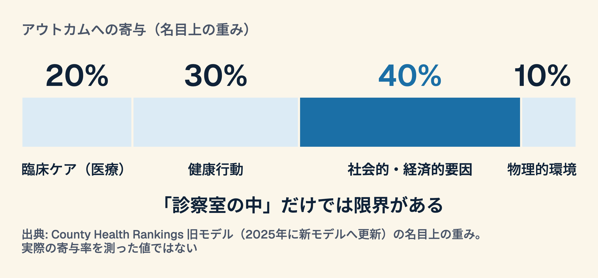
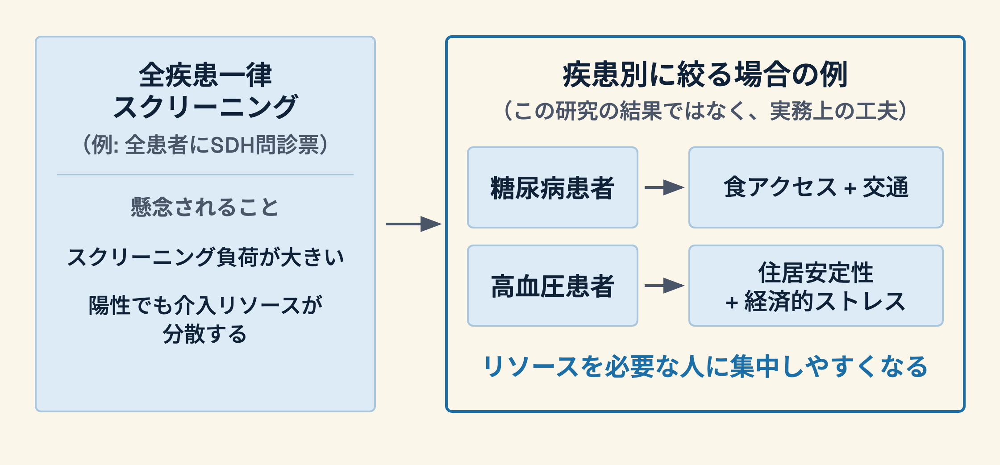

## あなたの患者さん、なぜコントロール不良のまま？

外来で2型糖尿病のHbA1cがなかなか下がらない患者がいる。
薬は処方している。指導もしている。でも改善しない。

**何を見落としているかもしれないか？**

---

# Part 1. 症例から考える

## 症例: 58歳女性、2型糖尿病 HbA1c 9.2%

- 内服アドヒアランスは「問題なし」
- 食事指導は毎回実施
- しかし…

  - 食料品店まで車で40分
  - 近所のコンビニが主な食料源
  - 公共交通なし、受診コストが高い

**「食事指導」は届いていたか？**

---

## 健康アウトカムを決めるのは何か

---

## 健康の社会的決定要因（SDH）とは

SDH（Social Determinants of Health）= 人の健康に影響を与える社会的・経済的・環境的条件

- **住居** — 安定性、過密、環境有害物質
- **食** — 食料安全保障、食アクセス
- **交通** — 受診の可否、移動能力
- **経済** — 収入、雇用、経済的安定性
- **社会的サポート** — 孤立、コミュニティのつながり
- **教育** — リテラシー、ヘルスリテラシー

---

# Part 2. All of Us 研究のエビデンス

## 26万人の研究が示したこと

**All of Us Research Program のデータを用いた予測研究 (medRxiv 2026・査読前)**

- n = 259,186人（参加者の自己申告データ）
- 12のSDH領域と慢性疾患（メンタルヘルス群・心代謝群）との関係を機械学習で分析
- 比較対象: 人口統計学的因子（年齢・性別・人種/民族など）。臨床検査値との比較ではない

**主要結果**:
> 予測精度は、SDHのみのモデルが人口統計のみのモデルと**同程度かそれ以上**（メンタルヘルス AUC 0.678 vs 0.655、心代謝 0.633 vs 0.636）

---

## データを読む: 何がわかったか

- 「どのSDHが何の疾患に効くか」は疾患群によって異なっていた
- メンタルヘルス群: ストレス・差別・宗教/スピリチュアリティが影響の大きい領域
- 心代謝群: 年齢・近隣の荒廃・差別が主な予測因子
- 著者らは、一律の問診票より**疾患別のスクリーニング**が望ましいと解釈している（スクリーニングの効果を直接検証した研究ではない）

---

## 研究を批判的に見る

| 観点 | 評価 |
|------|------|
| サンプルサイズ | n=259,186 と大規模 |
| 対象集団 | 米国の参加者コホート（日本への外挿に注意） |
| 研究デザイン | 自己申告データによる予測モデル。因果の解釈には限界あり |
| プレプリント | medRxiv段階（査読前）— まだ確定ではない |

**「約80%は臨床ケア以外」は旧モデルの名目上の重みから出る数字で、実測値ではない。数字の一人歩きに注意**

---

## 疾患別に考えるとは（著者らの提案と実務上の例）

---

# Part 3. 社会的処方（Social Prescribing）

## 社会的処方とは

薬や手術ではなく、**社会資源・コミュニティへのつなぎ**を「処方」する

- リンクワーカー（地域コーディネーター）が患者を地域資源に橋渡し
- 食品バンク、移動支援、就労支援、居場所づくり
- 英国NHSでは2019年のNHS長期計画以降、リンクワーカーの配置を推進

**社会的処方そのものの効果は、今回の研究では検証されていない**

---

## 日本の文脈で考える

日本でのSDH対応の現状と課題:

- 特定健診での社会的背景把握は限定的
- 在宅医療・ケアマネジャーとの連携が一部の施設で実践
- 特定健診へのSDH項目の追加は、2026年11月時点で正式な決定を確認できない

あなたの職場でできる「今すぐ1歩」は何か？

---

# Part 4. 臨床応用を考える

## あなたの外来でできること

SDHスクリーニングを生活習慣病フォローに組み込む:

1. **食のアクセス**: 「近くにスーパーはありますか？主にどこで買い物しますか？」
2. **交通・移動**: 「受診に困ることはありますか？来るのに時間・お金はかかりますか？」
3. **経済的安定**: 「処方薬の費用が負担になることはありますか？」
4. **住居**: 「今の住まいで困っていることはありますか？」

---

## スクリーニングから介入へ

陽性をどう活かすか:

- **院内連携**: MSW（医療ソーシャルワーカー）への紹介
- **地域連携**: ケアマネジャー、行政窓口、食支援NPO
- **制度活用**: 生活保護・障害年金・介護保険の確認
- **記録**: EHRへのSDH情報記録（未来の医師・スタッフへの継承）

「医師が全部やる」ではなく「チームでつなぐ」

---

## ディスカッション（5分）

**ペアで話し合ってください:**

> あなたの外来に、コントロール不良の慢性疾患患者がいるとします。
> SDHの視点で「見直したいこと」を1つ挙げるとしたら？

（5分後に2グループで共有）

---

## 実践の障壁と対処

よくある声と返し:

| 障壁 | 対処 |
|------|------|
| 「時間がない」 | 2問の簡易スクリーニングから始める |
| 「解決策がない」 | MSW・ケアマネに紹介するだけでOK |
| 「医師の仕事ではない」 | 診療の質に関わる情報として位置づける |
| 「患者が嫌がる」 | 「お体以外で心配なことはありますか？」の一言から |

---

# Part 5. まとめ

## 今日の3つのメッセージ

1. **SDHは、慢性疾患の予測で人口統計学的因子と同程度に寄与しうる**（26万人の予測研究・査読前）

2. **疾患別のスクリーニングが望ましいと著者らは提案**（効果の検証はこれから）

3. **社会的処方は、効果を確かめながら試す価値のある介入**（配慮や優しさだけでなく、根拠を積む段階）

---

## 持ち帰りの問い

今日の勉強会を終えて、あなたに問います:

> **「あなたのチームで、SDHスクリーニングを1つ導入するとしたら、何から始めますか？」**

よければ、来週の外来で患者に1つだけ聞いてみてください。

---

## 参考文献

1. Kammer-Kerwick M, Dave Y, Parekh V, McDonald L, Watkins SC. Social Determinants of Health and Chronic Disease Risk Prediction in the All of Us Research Program. *medRxiv* 2026（査読前プレプリント）.
   <https://doi.org/10.64898/2026.03.19.26348851>

2. Abdalla SM, Galea S. Embracing complexity and innovation to tackle the social determinants of health（解説論文）. *BMJ Global Health* 2026.
   <https://pmc.ncbi.nlm.nih.gov/articles/PMC12931545/>
