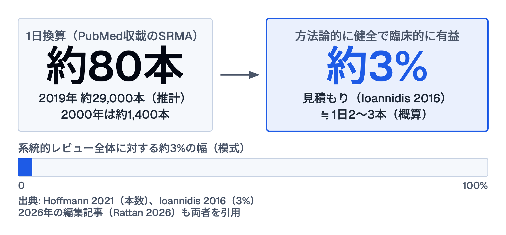

# エビデンスって信頼していいの? — SRMAの「3%問題」

---

## 今日の出発点

- 「論文がたくさんあるから信頼できる」は本当?
- 世界では1日約80本（2019年時点）の系統的レビューが発表されている
- 方法論的に健全で臨床的に有益なのは **約3%** という見積もりがある

---

## 約80本のうち、約3%

---

# Part 1. 系統的レビューって何?

---

## 系統的レビュー（SRMA）とは

- 同じテーマの複数の研究をまとめて分析した論文
- 「エビデンスのトップ」とされてきた
- ガイドラインの根拠になることが多い

→ でも今、その「トップ」に品質問題が起きている

---

## なぜ量産されているのか

- 研究者は「論文を出すこと」で評価される
- 系統的レビューは比較的速く作れる
- 結果: 質より量になってしまっている

---

# Part 2. 何が問題?

---

## 質の低いSRMAが起こすこと

1. 間違った情報がガイドラインに入る
2. 医療スタッフが誤った根拠を信じてしまう
3. 患者さんのケアに影響が出る

**「エビデンスに基づく医療」が逆効果になるリスク**

---

## 私たちにできること

| 場面 | 行動 |
|---|---|
| 論文を読む前 | 「この研究はどれだけ信頼できるか」と一問 |
| 会議・勉強会で | 「根拠は何か」を確認する習慣 |
| ガイドラインを使う時 | 「A推奨の根拠SRMAは質が高いか」を問う |

---

# Part 3. 職種別アクション

---

## 医師・研修医

- AMSTAR-2チェックリストを使う（5分）
- Forest plot の I²（ばらつきの目安）をざっと見る
- 「この推奨、どのSRMAが根拠?」と一歩踏み込む

---

## 看護師・コメディカル

- 「この手順はなぜ?」の問いを大切にする
- エビデンスの「強さ」より「質」を意識する
- チームで「根拠は?」と聞き合える文化をつくる

---

## 薬剤師

- 薬の適応・用量根拠のSRMAを時々見直す
- 出版バイアス（悪い結果が出にくい構造）を知っておく
- 患者説明に使うエビデンスの質を一段チェックする

---

# Part 4. まとめ

---

## 今日の3つのポイント

1. 系統的レビューでも **質に大きな差** がある
2. 信頼できて臨床に有益なのは**約3%**という見積もりがある
3. 「論文があるから正しい」ではなく **「その論文の質は?」** が問い

---

## 持ち帰りのひと言

「エビデンスを信じることと、エビデンスを疑うことは矛盾しない」

品質を確認しながら使うのが、本当のEBMの姿

---

## ディスカッション

- 日頃の業務で「これ根拠あるの?」と思ったことはありますか?
- チームで「エビデンスの質」を話せる環境はありますか?
