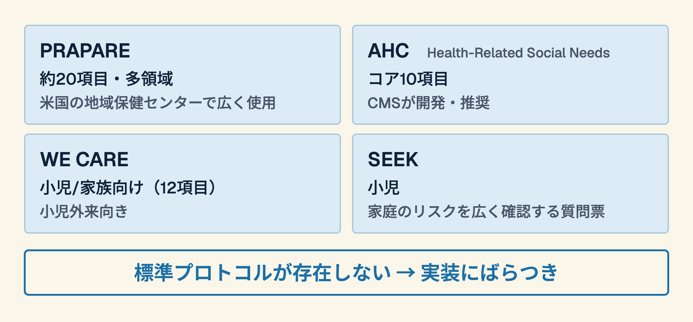
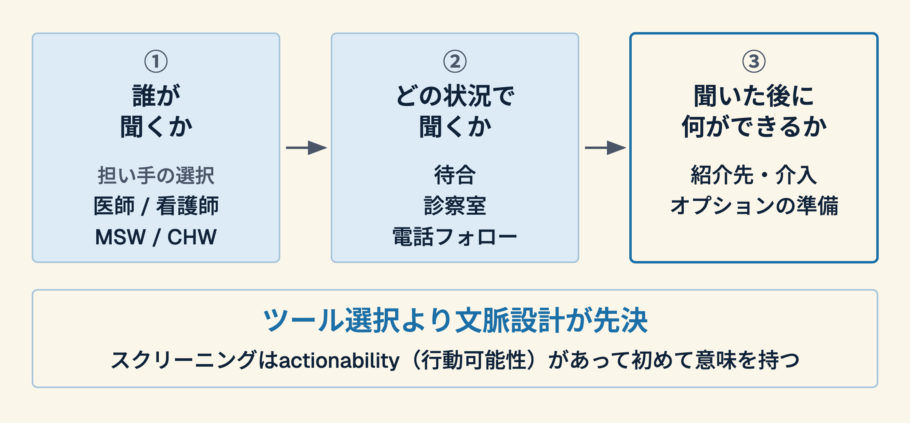

## 症例：60歳女性、血糖コントロール不良

- HbA1c 9.8%、3ヶ月おきの受診だが改善なし
- 薬は処方通り飲めていると言う
- 食事指導を繰り返すが変化がない
- → **何が見えていないのか**

---

## あなたは何を聞いたか

1. 食事内容を聞いた?
2. 運動習慣を聞いた?
3. **生活費・食費の余裕**を聞いた?
4. **一人で食事しているか**を聞いた?

> 聞かれていない問いに、答えは隠れている

---

## SDH（健康の社会的決定要因）とは

- **定義**: 人々が生まれ、育ち、働き、老いる環境の条件
- 食の安全 / 住居の安定 / 経済的余裕 / 孤立 / 教育 / 交通
- **WHOの見解**: 健康の不公平は社会的に決まる。社会的決定要因は、遺伝やヘルスケアへのアクセスより健康への影響が大きいことがある
- 慢性疾患の管理不良にも、ここが関わっていることがある

---

# Part 1. スクリーニングツールの全体像

---

## なぜ今スクリーニングが話題か

- 2022年：米国CMSが病院の質報告（入院）にSDoHスクリーニング指標を採択（2023年は任意、2024年報告から必須）
- 2025年：同指標を削除（FY2026 IPPS最終規則）→ **政策的揺り戻し**
- 2025年：JMIRにスクリーニングツールのスコーピングレビュープロトコル発表（結果の論文ではない）
- 日本：義務化なし、しかし無視できない臨床問題

---

## 代表的なスクリーニングツール

---

## 実装の現実 — 米国の地域保健センターの研究から

- テキサス州4センターの研究：実施の障壁は**時間と人手の不足**が中心
- 実施率は上がっても、人種・使用言語によって**スクリーニングされやすさに差**があった
- **ツールだけでなく「誰が・いつ聞くか」の設計**が実施を左右する
- 出典：De Marchis EH, et al. J Am Board Fam Med 2023;36:817

---

# Part 2. 「何から始めるか」という問いを解剖する

---

## よくある問い vs 本質的な問い

| よくある問い | 本質的な問い |
|---|---|
| どのツールを使うか | スクリーニング後に何ができるか |
| 何問聞くか | 患者が答えやすい状況か |
| 電子カルテに入るか | スタッフが行動できるか |

> 「ツール選択」は問いの立て方が間違っている

---

## actionability（行動可能性）とは

- スクリーニングで**困窮が判明した後**に何が起きるか
- 紹介先の社会資源が存在するか
- スタッフが対応できるか
- → **行動可能性のないスクリーニングは患者の負担になりうる**

---

## 文脈設計の3要素

---

# Part 3. 日本の文脈で考える

---

## 日本の診察室にSDHはあるか

- 食の安全：「お米が買えない月がある」
- 住居：「冬に暖房をつけられない」
- 孤立：「誰とも話さない日が続く」

> こうした状況は、診察室の外にとどまらず  
> 診察室の中にも、**聞かれないまま**あるかもしれない

---

## 「まず1問から」戦略

- 全16項目を聞く必要はない
- 患者が**話しやすい1領域**を選ぶ
  - 食の安全：「食事に困ったことはありますか？」
  - 孤立：「最近、誰かと食事しましたか？」
  - 住居：「寒さや暑さで困ったことはありますか？」
- → **問いを立てること自体が介入になる**

---

## ペアワーク（3分）

あなたの外来の患者を1人思い浮かべてください

1. 治療の反応が悪い原因として、SDHが関わっている可能性はあるか?
2. 今日明日から聞けそうな1問は何か?
3. → その後に**何ができるか**を考えてみよう

---

## 持ち帰りの3点

1. ツール選択より**文脈設計**が先決
2. スクリーニングは**actionabilityがあって初めて意味を持つ**
3. 始め方は「まず1問」 — 1問が患者との信頼を開く

---

## 参考文献

1. Martínez-Alfonso J, et al. Social Determinants of Health Screening Tools for Adults in Primary Care: Protocol for a Scoping Review. JMIR Research Protocols 2025;14:e68668（プロトコルであり、結果は含まない）
   <https://doi.org/10.2196/68668>
2. WHO. Social determinants of health.
   <https://www.who.int/health-topics/social-determinants-of-health>
3. De Marchis EH, et al. "Wanting the Best for Our Folks": a mixed methods analysis of community health center social risk screening initiatives. J Am Board Fam Med 2023;36(5):817-831.
   <https://doi.org/10.3122/jabfm.2023.230099R1>
