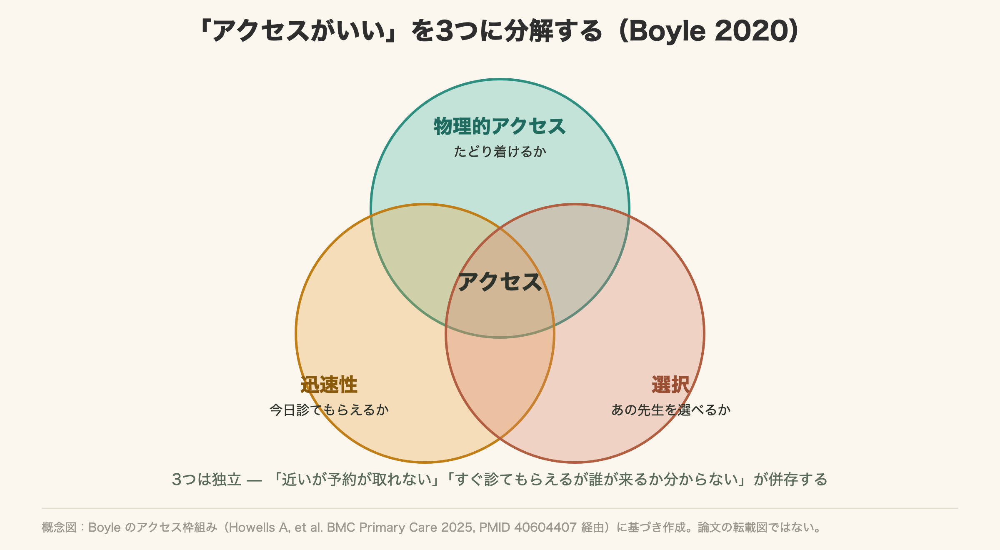
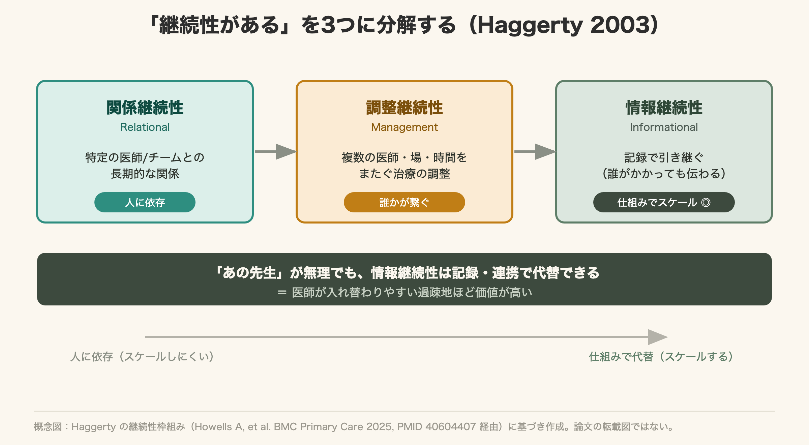
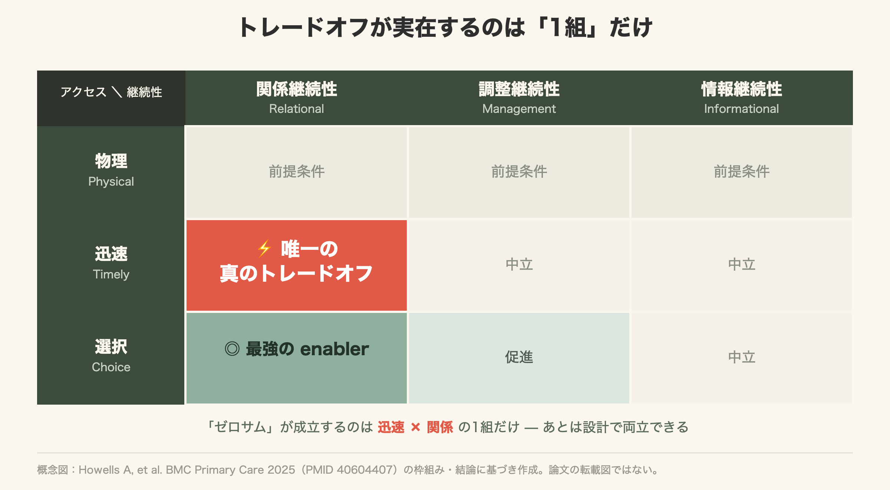
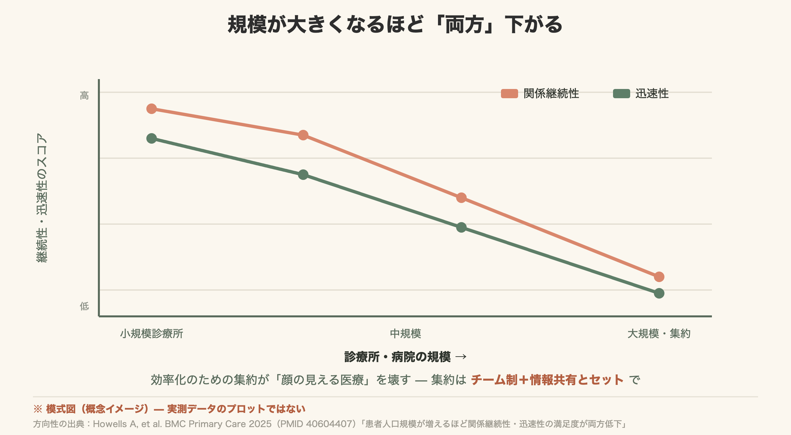

# "あの先生がいい"を分解する
## アクセスと継続性の設計学

---

## 今日のゴール — 終わったら、できること

- **アクセスと継続性を「分解」して語れる** — Boyleの3次元 × Haggertyの3類型で
- **本当にトレードオフになる場所を見分けられる** — 根拠: 2025年のシステマティックレビュー（BMC Primary Care・56論文）
- **明日から"情報継続性"を1つ実践すると決める** — 最もスケールする継続性

構成: 概念（30分）→ ワーク（30分）→ 現実解（20分）→ 宣言（10分）

---

## なぜ日本で「同じ先生」が続かないのか

| 特徴 | 日本 | 英国（比較） |
|------|------|------------|
| 医療機関の選択 | 自由（登録制なし） | 原則、登録GPのみ |
| 当日受診のしやすさ | 紹介状なしで当日も受診しやすい | 予約枠が制約 |
| 同じ医師に続けてかかれるか | **構造的に弱い** | 登録制が自動的に担保 |

- 逆説: **選ぶ自由はあるのに、"選び続ける"仕組みがない**
- 人口減少で患者像が「急性の若者」→「**慢性・多疾患・認知症の高齢者**」へ
- この層ほど「待ってでもあの先生・あのチームに」と望む = 一番苦手な継続性の需要が増える

---

## フレーム① — Boyleらのアクセス3次元

- **① Physical access（物理的アクセス）** — 医師がいるか・近いか・電話/オンライン/往診。**前提条件**＝たどり着けなければ何も始まらない
- **② Timely access（迅速性）** — 当日予約・待ち時間の短さ・時間外。「今日診てもらえますか」
- **③ Choice（選択）** — 診療所や医師を選べるか。「あの先生に診てもらいたい」

3つは独立。「近いが予約が取れない」「すぐ診てもらえるが誰が来るか分からない」が併存しうる

---

---

## フレーム② — Haggertyの継続性3類型（2003）

- **① Relational（関係継続性）** — 特定の医師/チームとの**長期的な関係**。「先生が私を知っている」
- **② Management（マネジメント継続性）** — 複数の医師・場・時間をまたぐ**治療の調整**。「どこでも方針がぶれない」
- **③ Informational（情報継続性）** — 引き継ぎを可能にする**情報共有**。「過去の経緯が伝わっている」

「継続性 = 同じ先生にかかること」という誤解を崩す。情報継続性は記載やデジタル連携で**スケールできる**

---

---

## 核心 — トレードオフは「1組」だけ

| 　 | Relational | Management | Informational |
|--|-----------|------------|---------------|
| **Physical** | 前提条件 | 前提条件 | 前提条件 |
| **Timely** | ⚡ここだけ真のトレードオフ | 中立 | 中立 |
| **Choice** | ◎最強のenabler | 促進 | 中立 |

- 英国 "Advanced Access"（当日予約最優先）= timely を最大化 → **choiceを損ないうる** → relational が弱まりうる（研究結果は一致していない）
- **Choiceは関係継続性の最強のenabler。ただし"選べるだけ"では継続性は保証されない（必要でも十分でもない）**

---

---

## 患者は両方ほしい — 緊急性が優先を決める

| 状況 | 患者が優先すること | 効く継続性 |
|------|------------------|--------------|
| 急性（38歳・発熱） | **速さ**（timely） | 誰でも可 → 情報継続性で補完 |
| 慢性・複雑（78歳・多疾患） | **関係**（choice→relational） | 待ってでも"あの先生・あのチーム" |

- 患者は「速さか関係か」を選びたいのではない。**緊急性で優先が変わるだけ**
- 設計の含意: 同じ診療所でも「**当日枠（速さ）**」と「**再診枠（関係）**」を分ければ両方に応えられる

---

## ワーク① — 自院をマッピングする（10分）

**テーマ**: あなたの現場の「当日枠 vs 再診枠」を Boyle × Haggerty のマトリクスに置いてみる

- 当日枠は誰のため？ どの次元を最大化している？
- 再診枠は「選択 → 関係」への変換を作れているか？
- 情報は「あの先生がいなくても伝わる」構造か？

発表: 1グループ1分でマッピング結果と気づきを共有（答えは問わない、気づきを引き出す）

---

## ケースで判定する（5分 → 全体共有）

**ケースA: 38歳男性・昨日から38℃の発熱**
- 既往なし・内服なし・数回だけ受診歴。「今日診てほしい」
- → 最優先の次元は？ どの継続性が欠けても困る？

**ケースB: 78歳女性・心不全＋2型糖尿病＋軽度認知症**
- 複数科かかりつけ・介護保険利用中・長女付き添い。「いつものあの先生に」
- → 最優先の次元は？ 医師が交代したら何が壊れる？

---

## 規模拡大の落とし穴

論文の知見（56論文から）: 患者数が多い診療所ほど、**関係継続性の満足度が下がり、迅速性の満足度も（より小さい程度で）下がる**傾向（英国の研究・患者の回答に基づく。数値は示されていない）

- 患者数↑ → 当日枠の競争激化 → 迅速性↓
- 医師数↑ → 担当が分散 → 関係継続性↓（医師が多い診療所は迅速性が上がる一方、関係継続性が下がる傾向）
- 効率化のための集約が「顔の見える医療」を壊しうる

**日本への警告（解釈）**: 人口減少で集約が進む地域ほど、**集約は必ずチーム制＋情報共有とセットで**——でないと両方が消える

---

---

## 医師不足の現実解 — チーム継続性

- **現実**: 働き方改革・医師偏在で「1人のかかりつけ医」モデルが破綻する地域が増える
- **現実解（論文の示唆）**: チーム制（Team-based continuity）＝担当患者リストを持つ小チームが、アクセスと継続性の両方を高めうる
- 患者に「あなたのチームはA班」と認識させる
- 医師個人のリレーション → **チームのリレーション**へ昇格（management＋informationalで補完）

**日本での器（解釈）**: 地域包括ケア（医療・介護・予防・生活支援の多職種チーム）。看護師など医師以外の専門職との関係継続性は、論文が"研究の空白"と指摘

---

## 情報継続性 — スケールする代替

「あの先生でなくても、情報が引き継がれているから安心」

| レベル | 具体的な実装 | 誰がやるか |
|--------|------------|-----------|
| 即実践 | 引き継ぎを意識したカルテ記載 | 研修医・医師全員 |
| 診療所単位 | かかりつけサマリーを患者に渡す | チームで設計 |
| 地域単位 | 電子カルテ・医療情報の共有 | システム設計 |
| 国レベル | 全国医療情報プラットフォーム（医療DX） | 政策（解釈） |

**罠**: 情報継続性は「記録があること」でなく「**その情報が使われること**」で完結する

---

## 重要な罠 — 看板と実態の乖離

論文の警告: **「かかりつけ医を指定するだけ」では継続性は上がらない**——実際に継続診療が起きる構造が要る

- 日本（解釈）: かかりつけ医機能報告制度（2025年4月施行、初回の報告期間は2026年1〜3月）で「機能あり」と報告する診療所が出てきた
- **「報告した ≠ 機能している」**の乖離は、今後可視化されうる

**看板で終わらせない3点**:
- 患者が「自分のかかりつけ」を実感できる体験設計
- チームと情報の仕組みが整っている
- 受付・看護が継続性を支えている（次へ）

---

## 受付・看護・多職種が継続性を作りも壊しもする

論文の知見: **受付スタッフが、予約方針を支えも損ないもする**（希望の医師への予約を取れるように助けられる）

| スタッフの行動 | 継続性への影響 |
|--------------|-------------|
| 「次回は○○先生の枠がありますよ」 | 関係継続性 ↑ |
| 「今日空いている先生はBです」 | 関係継続性 ↓ |
| 看護師が毎回同じ患者を担当 | 関係継続性 ↑（医師不在でも） |
| 薬剤師・ケアマネへの情報共有 | 管理継続性 ↑ |

**継続性はチームで作る**——医師だけが作るわけではない

---

## 持ち帰り — 明日から1つ宣言

- **アクセスと継続性はゼロサムじゃない** — timely⟷choiceの1組だけが本当のトレードオフ、あとは設計で両立
- **日本のフリーアクセスは"選択の過剰"** — 問題は変換装置がないこと。チームと情報で「選べる自由→続く関係」へ
- **情報継続性は今日から始められる** — 「次の先生が読んで分かるカルテ」が最もスケールする実践

**宣言ワーク（5分）**: 明日から自分の再診患者に「情報継続性」で何ができるか、1つだけ書く

---

## 参考文献・出典

### 一次文献（主要根拠）
- Goff M, Hindi A, Hammond J, Jacobs S. *Access or continuity: a zero sum game? A systematic review of the literature examining the relationship between access and continuity in primary healthcare.* BMC Primary Care, 2025;26:202. PMID 40604407
  https://doi.org/10.1186/s12875-025-02860-8

### 概念フレーム（二次文献）
- Haggerty JL, et al. *Continuity of care: a multidisciplinary review.* BMJ, 2003;327:1219（継続性3類型の原典）
- Boyle S, Appleby J, Harrison A. *A rapid view of access to care.* The King's Fund（アクセス3次元。上記レビューは Boyle et al. 2020 として引用）
- Levesque JF, Harris MF, Russell G. *Patient-centred access to health care: conceptualising access at the interface of health systems and populations.* Int J Equity Health, 2013;12:18

### 注意
- 質的評価は論文著者も未実施。「確定エビデンス」でなく「もっともらしい統合モデル」として扱う
- 56論文は多国の研究を含むが、論文に日本は登場しない。日本のフリーアクセスへの直接適用は慎重に
- 規模と継続性の図は模式図（数値のない概念図）
- 「日本への翻案」（かかりつけ医機能・地域包括ケア・医療DX等）はConductorの解釈。制度名・施行時期は東京都ほか自治体の案内（厚労省の制度資料に基づく）で確認済み（2026-11-09）
