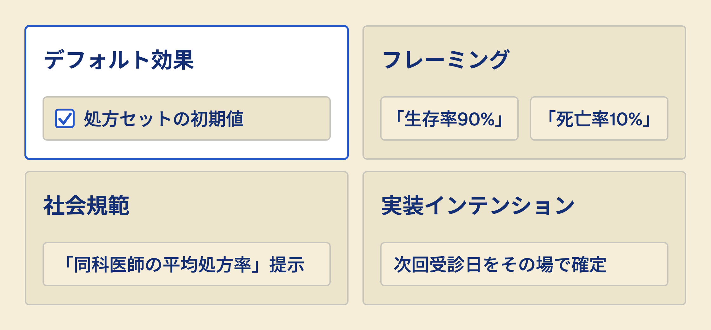

# あなたはすでに選択設計者である
## ナッジと処方デフォルト（Frontiers in Public Health 2026 展望論文）

---

## 症例：38歳男性、3日前からの咽頭痛

- 発熱 37.8℃、咳嗽あり、膿性鼻汁なし
- Centorスコア 1点、迅速検査は陰性
- 「前回もらった抗菌薬がよく効いたので、また出してほしい」
- → **あなたはEMR（電子カルテ）の処方画面を開いた**

---

## その画面に、最初から何が入っていたか

1. 空欄だった?
2. 前回処方がコピーされていた?
3. 「セット」が選択済みだった?
4. **そのセットを決めたのは誰か**

> 開いた瞬間に、選択はもう始まっている

---

## 今日のゴール

- ナッジと選択アーキテクチャを説明できる
- 自院の処方画面に埋め込まれたデフォルトを1つ特定できる
- デフォルト変更の倫理的な問い所を述べられる

---

## ナッジとは

- 選択の自由を保ちながら行動を誘導する介入
- 禁止しない・経済的インセンティブを大きく変えない
- Thaler & Sunstein『Nudge』(2008 / 2021改訂)
- 規制より低コストで実装しうる政策手段

---

## 選択アーキテクチャの4類型

---

## 今日の論文

- Nudge for governmental change in health policy
- Alsaqqa HH, Frontiers in Public Health, 2026年1月
- **展望論文（perspective）— 原著研究ではない**
- 抗菌薬処方・検診受診・生活習慣で有効性を論じる

---

## 展望論文をどう読むか

1. 主張の新規性はどこか
2. 引用されている一次研究は何か
3. 著者の立場・利益相反は
4. **「有効」の効果量は示されているか**

> 展望論文は地図であって、測量結果ではない

---

## デフォルト効果がなぜ効くか

- 変更には能動的な操作コストがかかる
- 初期値は「推奨」という暗黙のメッセージを帯びる
- 忙しい外来ほど初期値が残りやすい
- → **設定画面も、診療の質に効いている**

---

## 抗菌薬処方への応用

- 上気道炎の処方セット初期値を「対症療法」に
- 抗菌薬は能動的に上書きした場合のみ処方
- 導入障壁は設定権限に加え、院内承認・ベンダー仕様・処方者の抵抗など
- AMS（抗菌薬適正使用支援）の実装手段の候補（本論文は初期値変更を扱っておらず、教材側の応用例）

---

## Part 2 — 批判的に見る

---

## 「選択の自由は保たれる」は本当か

- 設計者の価値観は構造として埋め込まれる
- 誰がどのデフォルトを、誰の利益で設定したか
- 透明性がなければ操作と区別がつかない
- → ナッジ批判の核心はここ

---

## リバタリアン・パターナリズム

- 自由主義（選択は残す）＋温情主義（善い方へ導く）
- 矛盾する2語を接続した造語
- 「善い方」を誰が定義するのかが常に争点
- 医療では**アウトカム改善**が根拠になりやすい

---

## 文化的文脈への依存

- 社会規範ナッジは規範の内容に依存する
- ある国で有効な提示が別の国では反発を生む
- 日本の外来での検証データは限られる
- → 海外知見の直輸入に注意

---

## EU AI Act とデジタルナッジ

- 2024年8月発効。高リスクAIの義務は 2026年8月2日の予定だったが、改正規則 (EU) 2026/1744 で延期（官報 2026年7月24日）
- 延期後の適用は、単独型が2027年12月、製品組込型（医療機器など）が2028年8月
- 「透明性義務」と「操作的AI禁止」を併記
- 日本の医療AIにも設計思想として波及しうる（教材側の補足）

---

## 2026〜2030の見通し（教材側の推測）

- EMR組み込みAIナッジが広がる可能性
- 患者固有リスクを計算しリアルタイムで初期値を変える形も考えられる
- 抗菌薬・オピオイド・不要検査が候補
- **開示と説明可能性が導入条件になりうる**

---

## Part 3 — 自分の現場へ

---

## ワーク①：デフォルトを1つ挙げる

- 処方画面・検査オーダー・紹介状テンプレート
- 「最初から入っているもの」を1つ書き出す
- 隣の人と交換して読む
- 所要3分

---

## ワーク②：誰が決めたかを辿る

1. その初期値はいつ設定されたか
2. 設定した人は今も在籍しているか
3. 変更するには誰の承認が要るか
4. **変えたら患者アウトカムはどう動くか**

---

## ワーク③：1つだけ変えるなら

- 変更対象を1つに絞る
- 期待する変化を数値で書く（例：抗菌薬処方率）
- 測定方法を1行で書く
- 所要5分

---

## 明日からの1歩

- EMRベンダーに「処方セットの初期値は変更可能か」を問い合わせる
- 現行の設定画面をスクリーンショットで保存する
- 所要1時間・承認不要
- → 選択設計者としての最初の一手

---

## まとめ

- 処方画面はすでに選択アーキテクチャである
- デフォルトは中立ではない
- 変更の是非は透明性で決まる
- **受動的ユーザーから能動的設計者へ**

---

## 参考文献

- Alsaqqa HH. Nudge for governmental change in health policy. Front Public Health 2026;14:1739353
  <https://www.frontiersin.org/journals/public-health/articles/10.3389/fpubh.2026.1739353/full>
- Thaler RH, Sunstein CR『NUDGE 実践 行動経済学 完全版』日経BP, 2022
  <https://www.amazon.co.jp/dp/4296000985>
