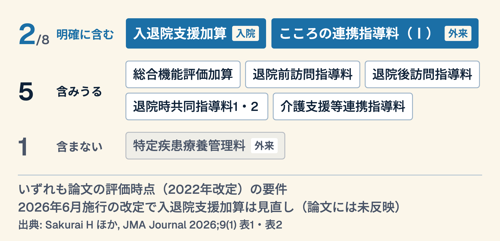

# 社会を診る医療は、いくらで評価されているか
## SDHと日本の診療報酬8プログラム（JMA Journal 2026;9(1) ナラティブ政策レビュー）

---

## 症例：78歳女性、心不全で3回目の入院

- 内服アドヒアランス不良、独居
- 「薬は飲んでる」と言うが残薬が多い
- 訪問時、冷蔵庫はほぼ空
- → **経済的困窮と孤立が背景にある**

---

## あなたはその背景を拾った

1. 生活費の余裕を聞いた
2. 食事の実態を確認した
3. 民生委員につないだ
4. **この関わりは、何点になったか**

> 拾えたことと、評価されることは別

---

## 今日のゴール

- SDH（Social Determinants of Health：健康の社会的決定要因）が日本の診療報酬にどう埋め込まれているか説明できる
- 自分の関わりが加算対象か判断できる
- 制度の空白を具体的に指摘できる

---

## 診療報酬という「お金の流れ」

- 何を評価するかの国家的な意思表示
- 点数がつく行為は記録され、統計になる
- 点数がつかない行為は**統計に残りにくい**
- → 制度設計はケアの可視性を決める

---

## 今日の論文

- 健康の社会的決定要因（SDH）からみた日本のプライマリケア診療報酬プログラムのレビュー
- Sakurai H ほか10名（京都大学 社会疫学ほか）、JMA Journal 9(1)、2025年12月オンライン公開
- **ナラティブ政策レビュー**
- 診療報酬8プログラムをSDH観点で分析

---

## 結果：8つのうち、いくつか
### SDH要素を明確に含むもの

---

## この数字をどう読むか（教材側の解釈）

- SDHを明確に含む点数は、評価時点では少なかった
- SDHが要件に明記されたのは2022年改定（論文の整理）
- それ以前の実践は記録に残りにくかったと考えられる
- → 現場の実感と記録の乖離が生じうる

---

## 構造的な3つの課題

| 課題 | 内容 |
|---|---|
| 任意設定 | SDH評価項目の多くが必須でなく、項目も曖昧 |
| 場面の偏り | 評価場面が入院に偏り、外来・在宅でSDHを評価できる枠組みが少ない（本レビューの範囲） |
| 連携項目の欠如 | 医療外・介護との連携を促す要件がほぼない |

---

## 特に薄いのは外来と在宅

- プライマリケアこそSDHの最初の接点
- 本レビューの範囲では、外来・在宅の評価は入院より手薄
- 医療外機関との連携が**義務化されていない**
- → 拾っても、つなぐ先が制度化されていない

---

## Part 2 — 批判的に見る

---

## ナラティブレビューの限界

1. 系統的検索ではない（選択バイアス）
2. プログラム選定基準が明示的か
3. 「SDH要素を含む」の判定は誰がしたか
4. **効果の検証ではなく制度の記述**

> 制度の地図であって、成果の測定ではない

---

## それでも重要な理由

- 日本語の制度を国際誌の枠組みで記述した
- 8プログラムという具体的な母数を示した
- 2022年という時点を可視化した
- → 議論の出発点として使える

---

## 測られていないものは何か

- 診察室で拾った困窮
- つないだ先での結果
- つなげなかった理由
- **記録に残らない実践の総量**

---

## 著者らの提言

- SDH評価項目の明確化と収集様式の標準化
- 外来・在宅でも評価できる場面の拡大
- 医療外機関との連携の制度化
- → 2026年6月施行の改定で入退院支援加算は見直された（退院困難な要因に「家族・親族との連絡が困難」を追加など）
- 次の通常改定は2028年度

---

## Part 3 — 自分の現場へ

---

## ワーク①：今週の1例を思い出す

- SDHが関与したと思う症例を1つ
- どの社会的要因が効いていたか
- 付箋に1行で書く
- 所要3分

---

## ワーク②：それは加算になったか

1. 該当しそうな加算はあるか
2. 算定要件を満たしていたか
3. カルテに記載は残ったか
4. **残っていないなら、なぜか**

---

## ワーク③：記録の形を決める

- SDHを1問だけカルテに定型記載する
- 例：「生活費の余裕」を1週間だけ聞く
- 何件拾えたかを数える
- 所要5分で設計できる

---

## 明日からの1歩

- 自院の外来でSDHスクリーニングを1週間試験導入
- 現行の任意加算で何が拾えるかを記録
- 設計は30分〜1時間・承認不要
- → 制度の空白を自分のデータで示す

---

## まとめ

- SDHを明確に含む診療報酬は8中2、論文の評価時点ではいずれも2022年改定の要件（1つは新設）
- 外来・在宅の評価と連携義務化が特に薄い
- 点数がつかない実践は統計に残らない
- **記録することが、制度を動かす最初の材料になる**

---

## 参考文献

- Sakurai H, et al. 健康の社会的決定要因（SDH）の観点から見た日本のプライマリケア診療報酬プログラムのレビュー
  (JMA Journal 2026;9(1)、オンライン公開 2025-12-26、PMID 41676803、DOI 10.31662/jmaj.2024-0313)
  <https://pmc.ncbi.nlm.nih.gov/articles/PMC12889345/>
- 近藤克則『健康格差社会 — 何が心と健康を蝕むのか（第2版）』医学書院、2022（ISBN 978-4-260-04968-9）
  <https://www.amazon.co.jp/dp/4260049682>
