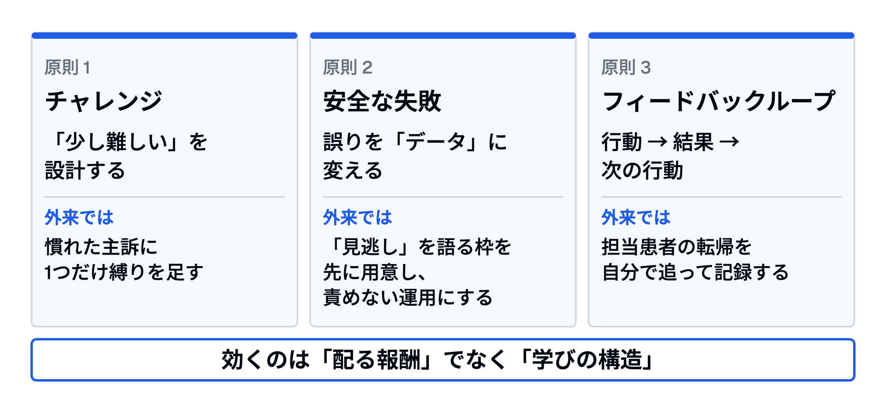

# 学びを「ゲーム」の構造で設計する
## チャレンジ・安全な失敗・フィードバックループ — ポイントとバッジの、その先

---

# Part 1. 症例: 学びが止まる場面

---

## 症例: 専攻医2年目、外来3か月目の「伸び悩み」

- 週2コマの外来、主訴は風邪・高血圧・腰痛の繰り返し
- 指導医の確認は診療後のカルテチェックのみ、コメントは「特に問題なし」
- 先月の見逃し（虫垂炎、翌日再診で判明）はカンファで言い出せないまま
- 本人の言葉: 「毎日やっているのに、伸びている気がしない」
- → **症例は足りている。足りないのは学びの「設計」**

---

## 今日のゴール

- ゲームデザインの3原則（チャレンジ・安全な失敗・フィードバックループ）を、学習理論の言葉で説明できる
- ゲーミフィケーションのメタ分析を、効果量と研究の質から批判的に読める
- 明日の外来・カンファの自分の学習に、3原則のどれか1つを設計して入れられる

---

## 前提: ポイント・バッジはなぜ短命か

- 表面の仕掛け: ポイント・バッジ・リーダーボード（いわゆる PBL: Points・Badges・Leaderboards）
- Hanus & Fox 2015: 16週の大学講義、バッジ+リーダーボード群で内発的動機と満足感が低下、期末成績も低下
- Deci ら 1999（128研究）: 予告された有形報酬は内発的動機を下げる（d = −0.28〜−0.40）
- 自己決定理論: 効くのは「自律性・有能感・関係性」を満たす設計
- → 問うべきは「何を配るか」でなく「**学びの構造をどう組むか**」

---

# Part 2. 3つの原則とエビデンス

---

## ゲーミフィケーションは効くのか: 3つの統合研究

| 研究 | 対象 | 主な結果 |
|---|---|---|
| Sailer & Homner 2020 | 一般教育、k = 9〜19 | 認知 g = 0.49 / 動機 0.36 / 行動 0.25 |
| van Gaalen 2021 | 医療職教育 44研究 | 負の結果なし。「評価 × チャレンジ」の組合せで教材利用が増加 |
| Lee 2026 | 臨床推論 10研究 N = 931 | SMD 1.11 → 出版バイアス補正後 0.75 |

- g / SMD = 標準化効果量（目安: 0.2 小・0.5 中・0.8 大）、k = 研究数

---

## 数字をどう読むか: 効果量の裏側

- 認知の効果（g = 0.49）は厳格な研究に絞っても安定、動機・行動の効果は不安定（Sailer）
- Lee 2026: 異質性 I² = 85%、GRADE 評価は「確実性が低い」、含まれた26研究の69%が学部教育 — 研修医への外挿は慎重に
- van Gaalen: 対照群が不明確な研究が多く、仕組み（メカニズム）を検討したのは 7/44
- 新奇性効果: 数週間の介入が中心、1年後の保持データはほぼ無い
- → 「ゲーム化すれば効く」でなく「**どの要素が、なぜ効くか**」を読む

---

## 原則1: 適切なチャレンジ — 「少し難しい」を設計する

- ゲーム: 難易度がプレイヤーの腕に合わせて段階的に上がる
- 理論: 発達の最近接領域（Vygotsky）、フロー（Csikszentmihalyi）、望ましい困難（Bjork）
- 望ましい困難: 学習中の「やりにくさ」が長期保持と転移を高める
- 外来では: 慣れた主訴に**1つだけ縛りを足す**（検査前に診断確率を宣言する、など）
- 落とし穴: 難しすぎると回避、易しすぎると退屈 — 難度は指導医と調整する

---

## 原則2: 安全な失敗 — 誤りを「データ」に変える

- ゲーム: 失敗は罰でなくフィードバック、すぐやり直せる
- Sinha & Kapur 2021「生産的失敗」: 先に解かせてから教えると概念理解・転移が向上（53研究、g = 0.36、忠実度が高いと 0.37〜0.58）
- Edmondson 1996: 病棟ユニット比較で、良いチームほど**報告される**投薬エラーが多い
- Edmondson 1999: 心理的安全性 → 学習行動 → チーム成果（51チーム）
- カンファでは: 「見逃し」を語る枠を先に用意し、語った人を責めない運用にする

---

## 原則3: 進捗が見えるフィードバックループ

- ゲーム: 行動 → 結果 → 次の行動、が秒単位で回る
- Hattie & Timperley 2007: フィードバックの平均効果 d = 0.79 — ただし種類で大差
- Kluger & DeNisi 1996（607効果量、教育に限らない統合）: **3分の1以上**の介入で成績がむしろ低下（平均は d = 0.41）
- 効くのは課題・プロセス・自己調整へのフィードバック、効かないのは「人」へのほめ・叱り
- 外来では: 担当患者の**転帰を自分で追って記録**する — 自前のループを持つ

---

## ゲームデザインの3原則
### チャレンジ・安全な失敗・フィードバックループ

---

# Part 3. 明日の自分の学習設計へ

---

## 研修医で試すと: Kaizen-IM（米国内科レジデント、2012–13）

- 毎日出題される Web 問題 + チーム / 個人のリーダーボード
- 16,427問が回答され、53%が17〜8時、29%が週末
- 同じ問題の再テストで正答率 +11.9%（1,046ペア）
- 脱落のオッズ比: 毎日やらない人で 4.5倍（95%CI 1.5〜13.6）、PGY3 で 4.3倍（1.4〜12.6）— 区間は広い
- → **毎日の小さな習慣**が残るかどうかを分けた（ただし2施設・対照群なし）

---

## 外来前5分のストリーク: マイクロゲーミフィケーション

- 発想: 短いチャレンジ・ストリーク・ナッジを日常業務に埋め込む（教材側の提案）
- 例: 外来前の5分で「今日1人だけ、診察前に診断仮説を紙に書く」→ 診察後に答え合わせ
- 3原則が全部入る: 少し難しい（仮説を先に言う）/ 安全（紙は自分だけ）/ ループ（即日答え合わせ）
- 根拠の一部: ログ上で連続記録が目立つと、次の行動が増える（Silverman & Barasch 2023、消費者行動の7実験。学習場面での検証ではない）
- 注意: 途切れたら「修復可」にしておく — 完璧主義には逆効果

---

## ペアで2分: 自分の学習に1つ入れる

1. 3原則から1つ選ぶ（チャレンジ / 安全な失敗 / ループ）
2. 明日の外来かカンファで「何を・いつ・どう記録するか」を1文で
3. 相手に言う、相手の設計を聞く（各1分）
4. **全体で2〜3人に共有**

---

## ふりかえり: 3つの問い

- ポイント・バッジと3原則の違いを、理論の言葉で一言で言うと?
- Lee 2026 の SMD 1.11 を、そのまま信じない理由を2つ挙げると?
- 自分の「1つ」は、1か月後に何で続いているか確かめる?

---

## まとめ

- 効くのは「配る報酬」でなく「学びの構造」: 少し難しい・失敗できる・進捗が見える
- 効果量は小〜中（g ≈ 0.3〜0.5）、医学教育の証拠は質が低い — 期待は控えめに、設計は本気で
- 明日の一手: 外来前5分、診断仮説を1つ紙に書く
- **症例は足りている。足りないのは学びの設計**

---

## 参考文献

- Sailer M, Homner L. The Gamification of Learning: a Meta-analysis. Educ Psychol Rev 2020;32:77–112.
  <https://doi.org/10.1007/s10648-019-09498-w>
- van Gaalen AEJ, et al. Gamification of health professions education: a systematic review. Adv Health Sci Educ 2021;26(2):683–711.
  <https://doi.org/10.1007/s10459-020-10000-3>
- Nevin CR, et al. Gamification as a tool for enhancing graduate medical education. Postgrad Med J 2014;90(1070):685–693.
  <https://doi.org/10.1136/postgradmedj-2013-132486>
- Hattie J, Timperley H. The Power of Feedback. Rev Educ Res 2007;77(1):81–112.
  <https://doi.org/10.3102/003465430298487>
