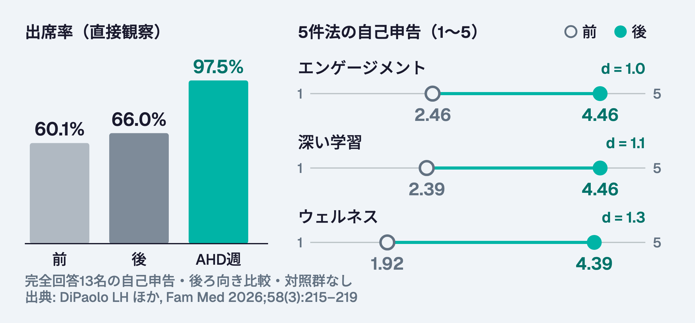

# 学びの時間を「守る」と何が変わるか
## 学術半日（AHD）ハイブリッドモデル — 出席率97.5%の読み方と、月1回3時間の試作設計

---

# Part 1. 問い: うちのカンファは守られているか

---

## 場面: 木曜12時、昼カンファの部屋（想定）

- 演者は準備した。集まったのは研修医 9 名中 5 名
- 1 名は病棟の PHS で退席、1 名は外来が押して 12:20 に到着、弁当を開けた頃に終了
- 出席簿は「出席」。年次評価の自由記述は「講義は良いが、聞ける状態で来られない」
- 米国 2 施設の ACGME（Accreditation Council for Graduate Medical Education: 米国卒後医学教育認定協議会）調査では「学習のための保護時間」が守られていると答えた研修医は 47%
- → 問題は演者の質でなく、**時間の設計**

---

## 今日のゴール

- DiPaolo 2026 の数値（出席率 97.5%・d = 1.0〜1.3）を、設計と測定の限界込みで説明できる
- 単群・後ろ向き前後比較・自己申告の研究として、効果量をどこまで割り引くか判断できる
- 自施設の「月1回 3 時間の保護時間パイロット」を、時間・カバー・工数・評価指標の 4 点で設計できる

---

## 前提: 学術半日（AHD）とは

- AHD（Academic Half Day: 学術半日）: 研修医を半日まとめて臨床業務から外し、教育専用の時間にするモデル
- 対比は昼カンファ（NC: Noon Conference）: 業務の隙間に 1 時間、割り込みが前提
- 米国内科で先行。Batalden 2013（3 プログラム）の 6 原則: 時間と場所を守る / 能動的学習 / 内容の意図的配列 / 教員開発 / 研修医の予習と責任 / 継続的改善
- 内科・神経内科で出席率と研修中試験の改善報告あり（数値は Part 2）
- 家庭医療 2 プログラムでの検証が今回の DiPaolo 2026

---

# Part 2. DiPaolo 2026 を読む

---

## 研究の設計: 2施設・6か月・月1回のハイブリッド

- 米国カリフォルニア州 Redding の提携 2 家庭医療プログラム、研修医 27 名（PGY（Postgraduate Year: 卒後年次）1 が 10 名 / PGY2 9 名 / PGY3 8 名）
- 2024年1〜6月の 6 か月。月 3 週は従来の昼カンファ、**月 1 週だけ AHD**（正午で業務から外れる）
- 診療のカバー: 入院は指導医、産科は上級研修医
- 評価: 後ろ向き前後比較の自己申告調査（5 件法）+ 出席の直接観察 + ACGME 年次調査
- 回答 20 / 27 名（74%）、完全回答 13 名

---

## ビフォーアフター: 1枚に凝縮

| 指標 | 前 | 後 |
|---|---|---|
| 出席率（直接観察） | 60.1% | 66.0%、AHD 週は **97.5%** |
| エンゲージメント（1〜5） | 2.46 | 4.46（d = 1.0） |
| 深い学習（1〜5） | 2.39 | 4.46（d = 1.1） |
| ウェルネス（1〜5） | 1.92 | 4.39（d = 1.3） |

- いずれも p < 0.001。d = Cohen d（コーエンの d: 標準化平均差。目安 0.2 小・0.5 中・0.8 大）
- ただし完全回答 13 名の自己申告・後ろ向き比較・対照群なしで、論文から d の算出法は読み取れない。数字は次の吟味とセットで読む

---

## AHD導入の前後の変化
### 出席率と5件法の自己申告

---

## もう1枚: 保護時間は「感じ方」も「外部調査」も動いた

- 「学習時間は守られている」（1〜5）: 1.79 → 4.14（d = 1.0）
- ワークライフバランス（1〜5）: 1.77 → 4.23（d = 1.3）
- ACGME 年次調査: 「学習のための保護時間」遵守 47% → 71%、「教育と臨床のバランス」67% → 76%
- プログラム年次評価の講義の質: 「平均以下」30% → 0%、「平均以上」30% → 66%
- 研修医の希望: 週 1 回 AHD 60%（12 名）、今回のハイブリッド継続 30%、半々 10%

---

## 批判的吟味 ①: 誰を、どう測ったか

- n = 27、回答 20、完全回答 13 — 5 件法の平均が 1 人の回答で動く規模
- **後ろ向き前後比較**: 介入後に「前はどうだったか」を思い出して回答 → 印象で「前」が低く出やすい（ウェルネス前値 1.92 は 5 件法でほぼ最低）
- 全項目が自己申告。知識・技能・患者アウトカムの測定なし（著者も研修中試験への影響は「先行研究で結果が割れる」と明記）
- 同一コミュニティの提携 2 施設 — 著者自身が「一般化できない」と記載
- 6 か月の試行期間 — 継続後の減衰は未測定

---

## 批判的吟味 ②: d = 1.3 をどこまで信じるか

- d = 平均差 ÷ 標準偏差。5 件法で平均が 2 点以上動けば d > 1 は珍しくない — 尺度の粗さが d を大きく見せる
- 対照群なし → ホーソン効果（観察されている自覚による変化）と新奇性（月 1 回の「特別な日」）を分離できない
- 「効果量が大」= 変化を大きく**報告した**大きさ。学習の大きさではない
- それでも残るもの: 出席率 97.5% は直接観察、ACGME 調査は毎年の外部測定 — **行動と外部指標は動いた**
- 読み: 「守れば来る」は堅い。「守ればウェルネスが d = 1.3 で上がる」は割り引く

---

## 先行研究との整合: 方向は一致、大きさは様々

- Ha 2014（内科、364 名の比較コホート）: AHD 群で 3 年目の ITE（In-Training Examination: 研修中試験、IM-ITE-3）スコア +4.8（回帰係数、95%CI: 信頼区間 2.9–6.6。非無作為）、学習満足度 3.4 vs 3.0
- Randall 2020（内科、95 名）: 中核カンファの滞在時間 週 29.7 分 → 64.8 分、教育価値・満足の自己評価が改善（ウェルネスは測定あり、抄録に改善の明記なし）
- Greenberg 2026（神経内科）: 出席率 35% → 79%（各1か月の記録）、RITE（神経内科の研修中試験）71% vs 過去コホート 65%
- 共通の型: **出席と満足は堅く動く。知識試験は「動く報告もある」**
- 家庭医療固有の論点: 継続外来（continuity clinic）の枠が半日減る影響は未評価

---

## 指導医側のコスト: 0.1 FTE と「半日ローテの喪失」

- 移行に要した中核教員の工数: 0.1 FTE（Full-Time Equivalent: 常勤換算。週 0.5 日相当）
- AHD 1 回 = 研修医のローテーション半日の喪失。選択ローテの短い研修医ほど痛い
- 教員側の懸念（Ritchie 2019 の教員インタビューと同型）: 講師の確保、準備負荷、成果の不確実さ
- プログラム責任者の四つ巴: 財務の持続性・地域への診療提供・意味ある学習・ウェルネス
- 研修医が改善を求めた点: テーマの多様性、企画への研修医参加、双方向性

---

# Part 3. 自施設で試す

---

## 日本の文脈 ①: 働き方改革と「研鑽」の線引き

- 2024年4月〜 医師の時間外労働上限（A 水準 年 960 時間、B・C 水準 年 1,860 時間）。2026年11月9日時点で上限値の変更は確認できず、B 水準は2035年度末を目標に終了予定
- 厚生労働省通達（2019年 基発0701第9号）: 所定労働時間内の研鑽は**当然に労働時間**。時間外でも上司の明示・黙示の指示があれば労働時間
- 「自由参加の院内勉強会」は労働時間外にできる — 裏返すと、**教育を時間外に押し出す圧力**が制度側にある
- AHD 型は臨床半日を教育半日に置き換える設計 — 総労働時間を増やさず、教育を「業務」として位置づける
- 指導医が問うべき点: うちの勉強会は「業務」か「自由参加」か。研修医はどちらだと感じているか

---

## 日本の文脈 ②: 「保護時間」の規定はあるか

- ACGME 家庭医療プログラム要件 4.11（Core）: 「研修医には中核的な講義活動に参加するための保護時間を提供しなければならない」
- 日本専門医機構 総合診療専門研修プログラム整備基準（最新の令和8年6月19日改訂版を通読）: 保護された教育時間に相当する明示規定は**確認できず**
- 同基準にあるのは、指導医不在地域での「週 1 回の振り返り」「3 か月に 1 回の訪問」— 教育の頻度であって、時間の保護ではない
- → 日本では保護時間は**外から来ない。プログラムが自分で決める**

---

## 点検: うちのカンファはどちらに近いか

| 観点 | 割り込まれやすい時間 | 守られた時間 |
|---|---|---|
| 出席の記録 | 出席簿・自己申告 | 直接観察、欠席理由を記録 |
| 診療のカバー | 「PHS は持っていく」 | 代替担当を事前に指名 |
| 時間の位置 | 昼休み・時間外 | 所定労働時間内の半日 |
| 欠席の扱い | 個人の判断 | 例外条件をプログラムが明文化 |

- 4 行のうち右側がいくつあるか — 手元で数えてから次へ

---

## 設計ワーク 5 分: 月1回・3 時間の保護時間パイロット

1. **時間**: どの曜日の午後を、どのローテーションから外すか（月 1 回 × 6 か月）
2. **カバー**: 入院・外来・当直の代替は誰か（DiPaolo: 入院は指導医、産科は上級研修医）
3. **工数**: 企画 0.1 FTE 相当を誰の何から捻出するか（会議の統合・外部講師・研修医企画）
4. **指標**: 6 か月後に「続ける / やめる」を決める数値を 1 つ先に決める
- 隣と 2 分ずつ。最も詰まった項目を全体で共有

---

## 評価指標の候補: 何で「効いた」と言うか

- 出席率（直接観察。AHD 週と通常週を分けて記録）
- 「学習時間は守られている」の 1 項目を**介入前に同時測定**（後ろ向きにしない）
- 指導医の準備・運営時間の実測（0.1 FTE の検証）
- 診療側の指標: 代替担当の残業時間、外来枠の減少数、患者の予約待ち日数
- 6 か月後の判断基準を先に文章化: 例「AHD 出席 90% 以上かつ外来枠減 5% 以内なら継続」

---

## ふりかえり: 3 つの問い

- 出席率 97.5% とウェルネス d = 1.3 — 信頼度に差をつけるとしたら、理由は何か
- 後ろ向き前後比較を「前後同時測定」に変えると、この研究の何が変わるか
- 自施設で最初に壊れるのは、時間・カバー・工数・指標のどれか

---

## まとめ

- 「守れば来る」（97.5%）は堅い。「守ればウェルネスが大きく上がる」（d = 1.3）は割り引く
- 弱点は n = 27・後ろ向き前後比較・自己申告・対照なし — ただし方向は内科・神経内科の先行研究と一致
- 日本では保護時間は外から来ない — 所定労働時間内に置き、例外条件をプログラムが決める
- 次の一手: 月 1 回 3 時間、6 か月、指標 1 つ、判断基準を先に文章化
- **散逸した教育投資を、集約する**

---

## 参考文献

- DiPaolo LH, Moranda J, Mooneyham A, Evangelista E, Carney PA. An Innovative Model of Delivering Resident Didactics in Two Family Medicine Residency Programs. Fam Med 2026;58(3):215–219.
  <https://doi.org/10.22454/FamMed.2026.722512>
- Ha D, et al. Transitioning from a noon conference to an academic half-day curriculum model. J Grad Med Educ 2014;6(1):93–99.
  <https://doi.org/10.4300/JGME-D-13-00185.1>
- Batalden MK, Warm EJ, Logio LS. Beyond a curricular design of convenience. Acad Med 2013;88(5):644–651.
  <https://doi.org/10.1097/ACM.0b013e31828b09f4>
- 厚生労働省. 医師の研鑽に係る労働時間に関する考え方について（令和元年7月1日 基発0701第9号）
  <https://www.mhlw.go.jp/content/10800000/000526011.pdf>
